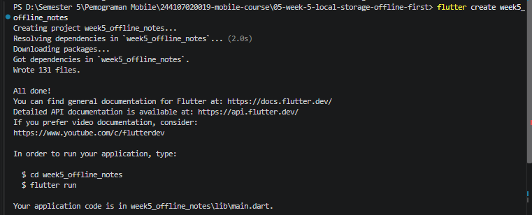
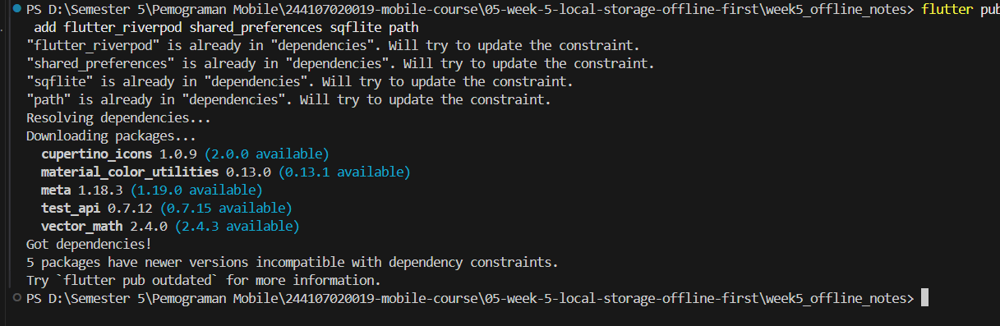
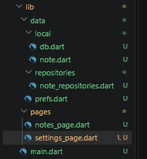
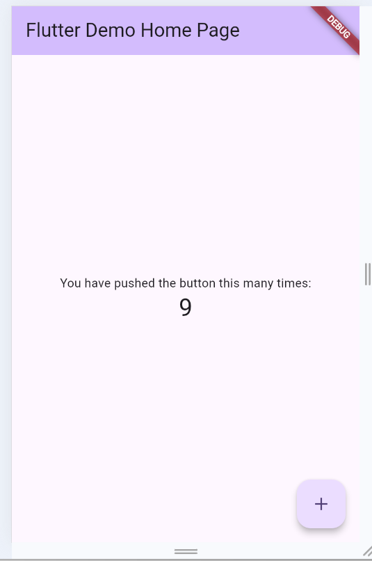
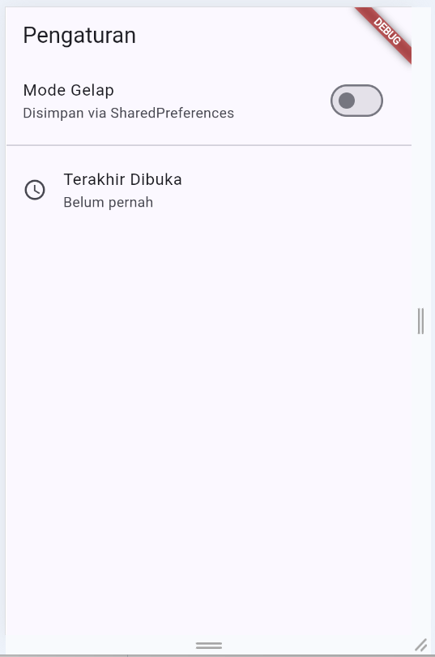
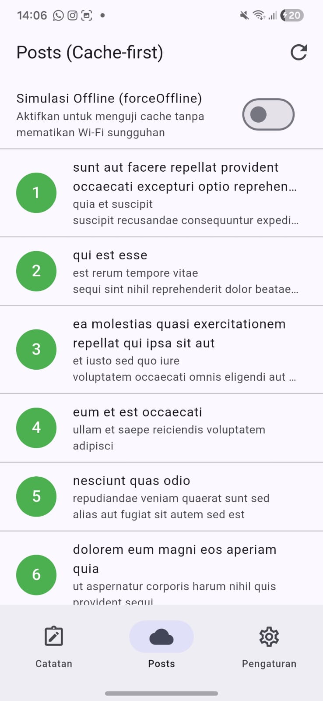
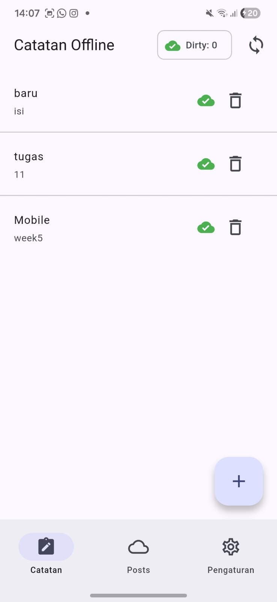

# Pemrograman Mobile
## Praktikum Week 5 - Local Storage & Offline-First (SharedPreferences + SQLite + Riverpod)

**Nama:** Fifa Nuuurn Halizah

**NIM:** 244107020019

**Kelas:** TI-3E  

## Praktikum 1: SharedPreferences

### Langkah-langkah Praktikum

---

### Langkah 1 — Siapkan Project

```bash
flutter create week5_offline_notes
cd week5_offline_notes
flutter pub add flutter_riverpod shared_preferences sqflite path
```
|  |
|  |
---

### Langkah 2 — Struktur Folder

```
lib/
├── main.dart
├── data/
│   ├── local/
│   │   ├── db.dart
│   │   └── note.dart
│   ├── prefs.dart
│   └── repositories/
│       └── note_repository.dart
└── pages/
    ├── settings_page.dart
    └── notes_page.dart
```
|  |
---

### Langkah 3 — Repository Preferensi

Buat lib/data/prefs.dart. Seluruh akses key-value terpusat di sini, bukan tersebar di widget:

**`lib/data/prefs.dart`**
```dart
// [Langkah 3]
import 'package:shared_preferences/shared_preferences.dart';

class PrefsRepository {
  static const _darkModeKey = 'dark_mode';
  static const _lastOpenedKey = 'last_opened_at';

  Future<bool> getDarkMode() async {
    final prefs = await SharedPreferences.getInstance();
    return prefs.getBool(_darkModeKey) ?? false;
  }

  Future<void> setDarkMode(bool value) async {
    final prefs = await SharedPreferences.getInstance();
    await prefs.setBool(_darkModeKey, value);
  }

  Future<void> markOpenedNow() async {
    final prefs = await SharedPreferences.getInstance();
    await prefs.setString(_lastOpenedKey, DateTime.now().toIso8601String());
  }

  Future<String?> getLastOpened() async {
    final prefs = await SharedPreferences.getInstance();
    return prefs.getString(_lastOpenedKey);
  }
}
```

---

### Langkah 4 — Provider dan Halaman Pengaturan

Contoh penyambungan minimal dengan Riverpod di lib/pages/settings_page.dart:
**`lib/pages/settings_page.dart`**
```dart
// [Langkah 4]
import 'package:flutter/material.dart';
import 'package:flutter_riverpod/flutter_riverpod.dart';
import '../data/prefs.dart';

final prefsRepositoryProvider = Provider((ref) => PrefsRepository());
final darkModeProvider =
    AsyncNotifierProvider<DarkModeNotifier, bool>(DarkModeNotifier.new);

class DarkModeNotifier extends AsyncNotifier<bool> {
  @override
  Future<bool> build() =>
      ref.watch(prefsRepositoryProvider).getDarkMode();

  Future<void> toggle() async {
    final next = !(state.value ?? false);
    state = const AsyncLoading();
    state = await AsyncValue.guard(() async {
      await ref.read(prefsRepositoryProvider).setDarkMode(next);
      return next;
    });
  }
}
```

---

### Langkah 5 — Jalankan

|  |
|  |
|  |

---

## Praktikum 2: SQLite dan Repository Catatan

### Langkah-langkah Praktikum

---

### Langkah 1 — Model Catatan
Buat lib/data/local/note.dart. Field dirty menandai catatan yang belum tersinkron:
**`lib/data/local/note.dart`**
```dart
// [Langkah 1]
class Note {
  const Note({
    this.id,
    required this.title,
    this.body = '',
    required this.updatedAt,
    this.dirty = false,
  });

  final int? id;
  final String title;
  final String body;
  final DateTime updatedAt;
  final bool dirty;

  Map<String, Object?> toMap() => {
        'id': id,
        'title': title,
        'body': body,
        'updated_at': updatedAt.toIso8601String(),
        'dirty': dirty ? 1 : 0,
      };

  factory Note.fromMap(Map<String, Object?> map) {
    return Note(
      id: (map['id'] as num?)?.toInt(),
      title: map['title'] as String? ?? '',
      body: map['body'] as String? ?? '',
      updatedAt: DateTime.tryParse(map['updated_at'] as String? ?? '') ??
          DateTime.fromMillisecondsSinceEpoch(0),
      dirty: ((map['dirty'] as num?)?.toInt() ?? 0) == 1,
    );
  }
}

---

### Langkah 2 — Pembuka Database

Buat lib/data/local/db.dart. Satu fungsi pembuka dipakai seluruh repository:

**`lib/data/local/db.dart`**
```dart
// [Langkah 2]
import 'package:path/path.dart' as p;
import 'package:sqflite/sqflite.dart';

Future<Database> openNotesDb() async {
  final dir = await getDatabasesPath();
  return openDatabase(
    p.join(dir, 'offline_notes.db'),
    version: 1,
    onCreate: (db, version) async {
      await db.execute('''
        CREATE TABLE notes(
          id INTEGER PRIMARY KEY AUTOINCREMENT,
          title TEXT NOT NULL,
          body TEXT NOT NULL DEFAULT '',
          updated_at TEXT NOT NULL,
          dirty INTEGER NOT NULL DEFAULT 0
        )
      ''');
      await db.execute('''
        CREATE TABLE cached_posts(
          id INTEGER PRIMARY KEY,
          payload TEXT NOT NULL,
          cached_at TEXT NOT NULL
        )
      ''');
    },
  );
}
```

---

### Langkah 3 — Repository sebagai Satu-satunya Pintu Data
Buat lib/data/repositories/note_repository.dart:
**`lib/data/repositories/note_repository.dart`**
```dart
// [Langkah 3]
import 'package:sqflite/sqflite.dart';
import '../local/db.dart';
import '../local/note.dart';

class NoteRepository {
  NoteRepository({Future<Database> Function()? openDb})
      : _openDb = openDb ?? openNotesDb;

  final Future<Database> Function() _openDb;

  Future<List<Note>> fetchNotes() async {
    final db = await _openDb();
    final rows = await db.query('notes', orderBy: 'updated_at DESC');
    return rows.map(Note.fromMap).toList();
  }

  Future<Note> addNote({required String title, String body = ''}) async {
    final db = await _openDb();
    final note = Note(
      title: title,
      body: body,
      updatedAt: DateTime.now(),
      dirty: true,
    );
    final id = await db.insert('notes', note.toMap());
    return Note(
      id: id,
      title: note.title,
      body: note.body,
      updatedAt: note.updatedAt,
      dirty: true,
    );
  }

  Future<void> deleteNote(int id) async {
    final db = await _openDb();
    await db.delete('notes', where: 'id = ?', whereArgs: [id]);
  }

  Future<int> countDirty() async {
    final db = await _openDb();
    final rows = await db.rawQuery(
        'SELECT COUNT(*) AS c FROM notes WHERE dirty = 1');
    return ((rows.first['c'] as num?)?.toInt() ?? 0);
  }

  Future<void> markAllSynced() async {
    final db = await _openDb();
    await db.update('notes', {'dirty': 0}, where: 'dirty = 1');
  }
}
---

### Halaman Catatan Offline

Catatan tersimpan di perangkat, jadi halaman ini tetap berfungsi penuh dalam mode pesawat. Tampilkan badge jumlah catatan yang belum tersinkron (dirty) sebagai indikator antrean sync.

---

### Langkah 5 — Jalankan dan Amati

|  |
|  | 
| |

---

## Praktikum 3: Cache-first dan Antrean Sync

### Langkah-langkah Praktikum

### Langkah 1 — Cache-first read untuk data API

Gunakan kembali endpoint Minggu 4 (GET /posts JSONPlaceholder). Alurnya: tampilkan cache lokal seketika, refresh dari jaringan di background, simpan hasilnya untuk kunjungan berikutnya:

**`lib/data/sync.dart` (bagian cache-first)**
```dart
// [Langkah 1]
Future<List<Post>> loadPostsCacheFirst() async {
  final cached = await readCachedPosts(); // dari tabel cached_posts
  // 1. Segera kembalikan cache agar UI tidak blank saat offline.
  // 2. Di background: fetch Dio -> simpan ke cached_posts -> invalidate provider.
  refreshPostsInBackground();
  return cached;
}
---

### Langkah 2 — Sinkronisasi catatan kotor (dirty)

Karena codelab ini belum punya backend tulis, simulasikan server dengan delay. Yang dinilai adalah mekanismenya, bukan servernya:

**`lib/data/sync.dart` (bagian sync notes)**
```dart
// [Langkah 2]
Future<int> syncNotes(NoteRepository repo) async {
  final dirtyCount = await repo.countDirty();
  if (dirtyCount == 0) return 0;
  // Simulasi upload: pada project nyata, kirim tiap catatan dirty
  // ke REST API di sini, lalu tandai bersih bila server menjawab 2xx.
  await Future.delayed(const Duration(seconds: 1));
  await repo.markAllSynced();
  return dirtyCount;
}
---

### Langkah 3 — Simulasi Offline yang Deterministik

Selain mode pesawat sungguhan, disediakan toggle `forceOffline` pada provider agar demo dan proses testing tidak bergantung pada kondisi Wi-Fi di kelas yang bisa tidak stabil.

Skenario pengujian yang dilakukan:

1. Matikan Wi-Fi / aktifkan mode pesawat, buka kembali aplikasi → catatan tetap tampil, badge `dirty` tetap akurat.
2. Nyalakan kembali koneksi, jalankan `syncNotes` → badge kembali ke `0`.
3. Langkah dan hasil observasi (screenshot sebelum/sesudah) disimpan ke folder `screenshots/`.

---

### Langkah 4 — Jalankan dan Uji

Dijalankan dengan `flutter run`, lalu diuji tiga kondisi berikut:

1. **Mode pesawat aktif** — daftar catatan dan cache posts tetap tampil, badge dirty menunjukkan jumlah catatan yang belum tersinkron.
2. **Tambah catatan saat offline** — catatan baru langsung tersimpan lokal dengan `dirty = true`, badge bertambah.
3. **Koneksi dinyalakan kembali, `syncNotes` dijalankan** — badge dirty kembali ke `0` setelah proses simulasi selesai.

| Online | Offline |Sebelum Sync | Sesudah Sync |
|---|---|---|---|
|  |  |  |  |

---

## AI Challenge

**Project:** lanjutan `week5_offline_notes`

### Peran AI pada Codelab Ini

AI boleh mengusulkan pilihan storage, tetapi keputusan akhir tetap di tangan praktikan. Nilai yang dicari ada pada kualitas perbandingan dan justifikasi, bukan pada kode mentah yang dihasilkan AI.

### Prompt yang Digunakan

```
Aplikasi Flutter Offline Notes: CRUD catatan + preferensi tema.
Bandingkan SharedPreferences, Hive, sqflite (SQLite), dan Drift
untuk dua kebutuhan ini. Requirements:
- Kriteria: kompleksitas query, kebutuhan relasi, reaktivitas (stream),
  type-safety, ukuran boilerplate, dan kemudahan testing.
- Beri rekomendasi final: mana untuk preferensi, mana untuk catatan,
  beserta alasannya dalam 1 tabel.
- Tunjukkan skema tabel/kotak untuk 1000+ catatan.
Jelaskan trade-off setiap pilihan.
```

**Tool AI:** ChatGPT

---

## Ringkasan Jawaban AI

| Kriteria | SharedPreferences | Hive | sqflite | Drift |
|---|---|---|---|---|
| Kompleksitas query | Rendah (key-value) | Rendah–sedang | Tinggi (SQL) | Tinggi (SQL + API Dart) |
| Kebutuhan relasi | Tidak cocok | Tidak native | Foreign key, join | Foreign key, join |
| Reaktivitas (stream) | Tidak ada | Bergantung API | Perlu dibuat manual | Sangat baik (watch) |
| Type-safety | Terbatas | Perlu adapter | Manual mapping | Sangat baik |
| Boilerplate | Sangat sedikit | Sedikit–sedang | Sedang–tinggi | Sedang (code-gen) |
| Kemudahan testing | Mudah | Relatif mudah | Perlu setup khusus | Mudah |

**Rekomendasi AI:**
- Preferensi tema → **SharedPreferences**
- Catatan → **Drift**

**Skema AI:** `id, title, content, created_at, updated_at`

---

## AI Verification Checklist

### 1. Apakah AI menempatkan daftar catatan di SharedPreferences?
✅ **Tidak.** AI menyarankan Drift untuk catatan. Rekomendasi benar.

### 2. Apakah skema AI mendukung antrean sync (dirty flag)?
⚠️ **Sebagian.** AI menyertakan `updated_at`, tapi **tidak ada `dirty`**. Kami tambahkan sendiri di `db.dart` karena offline-first butuh penanda antrean sync.

### 3. Apakah klaim "real-time" AI didukung stream?
✅ **Akurat.** AI benar: Drift punya `.watch()`, sqflite **tidak** punya stream bawaan.

### 4. Apakah estimasi boilerplate AI masuk akal?
✅ **Sesuai.** sqflite terasa "sedang" — tidak sesedikit SharedPreferences, tidak seberat Drift.

### 5. Keputusan final dan alasan
⚠️ **Berbeda dari AI.** Kami pilih **sqflite**, bukan Drift.

**Alasan:**
1. Skala codelab kecil — hanya 1 tabel, tanpa relasi.
2. Setup sqflite lebih cepat; Drift butuh `build_runner`.
3. Stream tidak dibutuhkan — `ref.invalidate()` cukup.

---

## Temuan Tambahan

- AI tidak menyebut tabel `cached_posts` untuk cache-first.
- Klaim "Hive = reaktif" agak kabur (Hive punya `ValueListenable`).
- Rekomendasi Drift valid secara teori, tapi overkill untuk skala codelab.

---

## Keputusan Akhir

| Kebutuhan | Pilihan |
|---|---|
| Preferensi tema | **SharedPreferences** |
| Catatan (CRUD offline-first) | **sqflite** |

---

## Refactoring dan Testing

Refactoring yang dilakukan pada `week5_offline_notes`:

- [x] Baris catatan diekstrak menjadi widget terpisah `NoteTile` yang menampilkan badge "belum tersinkron" bila `dirty == true`.
- [x] Logika cache posts dan `syncNotes` dipindahkan ke file `lib/data/sync.dart`, agar `NoteRepository` tetap fokus pada CRUD murni.
- [x] Ditambahkan halaman detail catatan dengan GoRouter (`/note/:id`) yang membaca dari repository lokal, bukan dari state halaman list.

**1. `NoteTile` (`lib/widgets/note_tile.dart`):**
```dart
// Dipisah dari NotesPage agar build() lebih pendek, dan badge
// "belum tersinkron" konsisten dipakai di semua tempat catatan ditampilkan.
import 'package:flutter/material.dart';
import '../data/local/note.dart';

class NoteTile extends StatelessWidget {
  const NoteTile({super.key, required this.note, required this.onTap});
  final Note note;
  final VoidCallback onTap;

  @override
  Widget build(BuildContext context) {
    return ListTile(
      title: Text(note.title, maxLines: 1, overflow: TextOverflow.ellipsis),
      subtitle: Text(note.body, maxLines: 2, overflow: TextOverflow.ellipsis),
      trailing: note.dirty
          ? const Chip(label: Text('Belum tersinkron'))
          : null,
      onTap: onTap,
    );
  }
}
```
## Mini Project — Offline Notes

**Bukti mode pesawat & sinkronisasi:**

|  |  |  |

---
## Refleksi

1. **Mengapa daftar catatan tidak boleh disimpan di `SharedPreferences`? Apa yang rusak jika aturan ini dilanggar?**
   `SharedPreferences` dirancang untuk pasangan key-value tunggal, bukan koleksi data. Jika daftar catatan disimpan di sana (misalnya sebagai satu string JSON besar), setiap kali ada satu catatan ditambah atau dihapus, seluruh list harus dibaca ulang, di-decode, diubah, di-encode lagi, lalu ditulis ulang secara keseluruhan — proses ini tidak efisien dan berisiko korup atau kehilangan data jika proses tertulis sebagian saat aplikasi tiba-tiba ditutup. Selain itu tidak ada mekanisme query, index, atau urutan bawaan, sehingga fitur seperti pengurutan `updated_at DESC` harus dikerjakan manual di memori setiap kali data dibaca.

2. **Kapan cache-first cukup, dan kapan Anda membutuhkan strategi lain (misalnya network-first untuk data harga real-time)?**
   Cache-first cukup untuk data yang bersifat *read-heavy* dan tidak sering berubah, seperti daftar post pada JSONPlaceholder — pengguna lebih diuntungkan melihat sesuatu segera walau sedikit usang, daripada menunggu jaringan. Untuk data yang berubah cepat dan harus selalu akurat, seperti harga saham atau status ketersediaan tiket real-time, strategi *network-first* (atau bahkan *network-only*) lebih tepat, karena data usang pada kasus ini bisa menyesatkan pengguna, bukan sekadar kurang up-to-date.

3. **Bagaimana dirty flag berubah menjadi antrean sync tanpa memblokir UI? Kapan antrean terpisah (tabel outbox) menjadi perlu?**
   Setiap perubahan lokal (tambah/ubah catatan) langsung disimpan ke SQLite dengan `dirty = true` secara instan, sehingga UI tidak pernah menunggu proses jaringan — proses `syncNotes()` berjalan terpisah dan hanya membaca baris-baris yang `dirty` saat dipicu. Tabel outbox terpisah menjadi perlu ketika operasi yang harus disinkron lebih kompleks dari sekadar "kirim state akhir", misalnya perlu mencatat urutan operasi (`insert`, `update`, `delete`) secara individual untuk direplay ke server satu per satu, atau ketika satu entitas bisa memiliki banyak operasi tertunda yang harus diproses berurutan.

4. **Bagian mana dari rekomendasi AI yang Anda tolak, dan mengapa?**
   Rekomendasi utama AI (SharedPreferences untuk preferensi, sqflite untuk catatan) diterima karena sesuai skala codelab ini. Namun saran AI agar mempertimbangkan Drift untuk masa depan tidak langsung diikuti pada tahap ini, karena overhead code generation Drift belum sepadan dengan kebutuhan aplikasi yang masih sederhana (tanpa relasi antar tabel dan belum butuh reaktivitas stream secara nyata) — keputusan ini akan ditinjau ulang bila kebutuhan aplikasi berkembang.