# Pemrograman Mobile
## Praktikum Week 6 - Authentication, Security & Firebase Cloud Messaging (FCM)

**Nama:** Fifa Nuuurn Halizah

**NIM:** 244107020019

**Kelas:** TI-3E  

# Praktikum 1: Login, Secure Storage & Token Refresh

### Langkah 1 — Siapkan project

```bash
flutter create campus_notify
cd campus_notify

flutter pub add flutter_riverpod go_router dio flutter_secure_storage
flutter pub add firebase_core firebase_messaging flutter_local_notifications

```
| 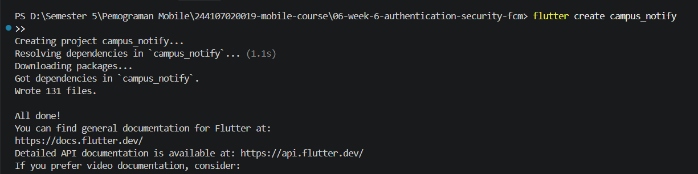 |
| 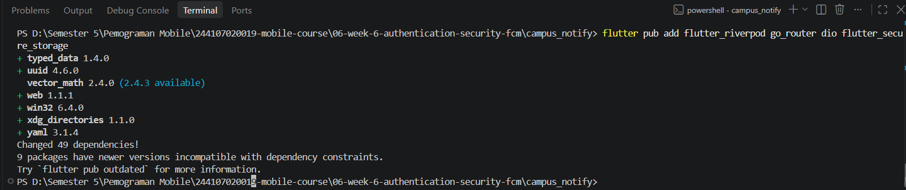 |
| 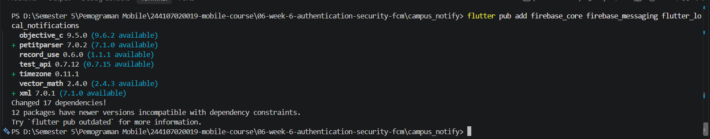 |

---

### Langkah 2 — Struktur Folder

```text
lib/
├── main.dart
├── data/
│   ├── auth_repository.dart
│   ├── token_store.dart
│   └── api_client.dart
├── providers/
│   └── auth_provider.dart
├── messaging/
│   └── push_service.dart
└── pages/
    ├── login_page.dart
    ├── home_page.dart
    └── announcement_page.dart
```

| 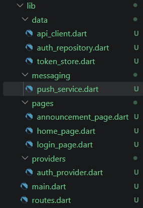 |

---

## 1. Penyimpanan Token yang Aman

Buat lib/data/token_store.dart. Seluruh token hanya keluar-masuk lewat kelas ini:

```dart
import 'package:flutter_secure_storage/flutter_secure_storage.dart';

class TokenStore {
  TokenStore({FlutterSecureStorage? storage})
      : _storage = storage ?? const FlutterSecureStorage();

  final FlutterSecureStorage _storage;

  static const _accessKey = 'access_token';
  static const _refreshKey = 'refresh_token';

  Future<void> save({
    required String access,
    required String refresh,
  }) async {
    await _storage.write(key: _accessKey, value: access);
    await _storage.write(key: _refreshKey, value: refresh);
  }

  Future<String?> readAccess() {
    return _storage.read(key: _accessKey);
  }

  Future<String?> readRefresh() {
    return _storage.read(key: _refreshKey);
  }

  Future<void> clear() {
    return _storage.deleteAll();
  }
}
```

Dengan pendekatan ini, UI tidak perlu mengetahui bagaimana token disimpan secara internal.

---

## 2. Repository auth (mock yang siap diganti Firebase Auth)

Buat lib/data/auth_repository.dart:


```dart
class AuthSession {
  const AuthSession({
    required this.access,
    required this.refresh,
  });

  final String access;
  final String refresh;
}

class AuthRepository {
  Future<AuthSession> login({
    required String email,
    required String password,
  }) async {
    await Future.delayed(
      const Duration(milliseconds: 500),
    );

    if (!email.contains('@') || password.length < 6) {
      throw Exception('Email atau kata sandi tidak valid');
    }

    return AuthSession(
      access: 'mock-access-for-$email',
      refresh: 'mock-refresh-for-$email',
    );
  }

  Future<String> refresh(String refreshToken) async {
    await Future.delayed(
      const Duration(milliseconds: 300),
    );

    if (refreshToken.isEmpty) {
      throw Exception('Refresh token hilang');
    }

    return 'mock-access-renewed-${DateTime.now().millisecondsSinceEpoch}';
  }
}
```


---

## 3. Dio dengan refresh otomatis

Buat lib/data/api_client.dart. Interceptor mencoba refresh satu kali saat menerima 401, lalu mengulang request:

```dart
import 'package:dio/dio.dart';

import 'auth_repository.dart';
import 'token_store.dart';

Dio buildApiClient(
  TokenStore store,
  AuthRepository auth,
) {
  final dio = Dio(
    BaseOptions(
      baseUrl: 'https://example-campus-api.test',
    ),
  );

  dio.interceptors.add(
    InterceptorsWrapper(
      onRequest: (options, handler) async {
        final access = await store.readAccess();

        if (access != null) {
          options.headers['Authorization'] = 'Bearer $access';
        }

        handler.next(options);
      },
      onError: (e, handler) async {
        if (e.response?.statusCode == 401) {
          final refresh = await store.readRefresh();

          if (refresh == null) {
            return handler.next(e);
          }

          try {
            final renewed = await auth.refresh(refresh);

            await store.save(
              access: renewed,
              refresh: refresh,
            );

            final retry = await dio.fetch(
              e.requestOptions
                ..headers['Authorization'] = 'Bearer $renewed',
            );

            return handler.resolve(retry);
          } catch (_) {
            await store.clear();
          }
        }

        handler.next(e);
      },
    ),
  );

  return dio;
}
```

## 4. Provider auth + guard route

Contoh lib/providers/auth_provider.dart dan pengaman GoRouter di main.dart:

```dart
final authStateProvider =
    AsyncNotifierProvider<AuthNotifier, bool>(
  AuthNotifier.new,
);

class AuthNotifier extends AsyncNotifier<bool> {
  @override
  Future<bool> build() async {
    final token =
        await ref.watch(tokenStoreProvider).readAccess();

    return token != null;
  }

  Future<void> login(
    String email,
    String password,
  ) async {
    state = const AsyncLoading();

    state = await AsyncValue.guard(() async {
      final session = await ref
          .read(authRepositoryProvider)
          .login(
            email: email,
            password: password,
          );

      await ref
          .read(tokenStoreProvider)
          .save(
            access: session.access,
            refresh: session.refresh,
          );

      return true;
    });
  }

  Future<void> logout() async {
    await ref.read(tokenStoreProvider).clear();
    ref.invalidateSelf();
  }
}
```

### Route Guard

```dart
GoRouter(
  redirect: (context, state) {
    final loggedIn =
        container.read(authStateProvider).value ?? false;

    final goingLogin =
        state.matchedLocation == '/login';

    if (!loggedIn && !goingLogin) {
      return '/login';
    }

    if (loggedIn && goingLogin) {
      return '/';
    }

    return null;
  },
  routes: [
    GoRoute(
      path: '/login',
      builder: (_, __) => const LoginPage(),
    ),
    GoRoute(
      path: '/',
      builder: (_, __) => const HomePage(),
    ),
    GoRoute(
      path: '/pengumuman/:id',
      builder: (_, state) {
        return AnnouncementPage(
          id: state.pathParameters['id'] ?? '',
        );
      },
    ),
  ],
)
```

---

## Hasil Praktikum 1


| 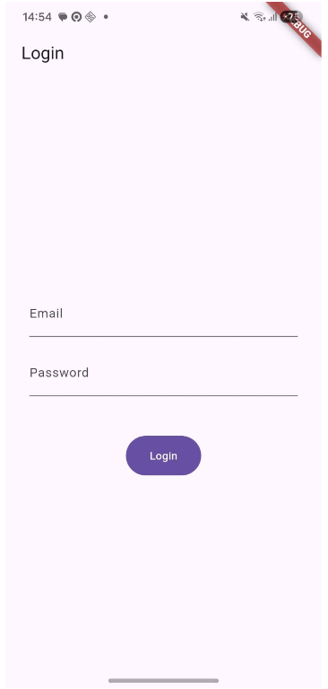 | 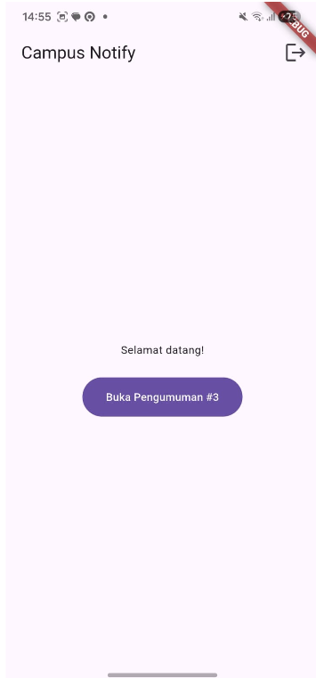 | 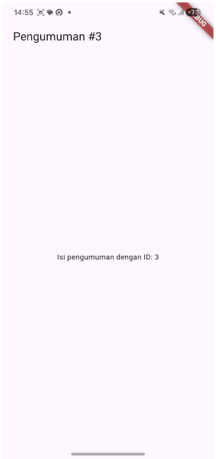 |

---

# Praktikum 2: FCM, Permission dan Token Lifecycle
---

## 1. Registrasi Firebase

1. Daftarkan aplikasi ke Firebase
Buat project di Firebase Console, tambahkan aplikasi Android dengan package name sesuai applicationId Anda.
2. Unduh google-services.json ke android/app/ dan ikuti panduan FCM Flutter client (terapkan plugin google-services dan dependensi). Untuk iOS tambahkan GoogleService-Info.plist.
3. Pastikan firebase_core diinisialisasi sebelum runApp: await Firebase.initializeApp().

| 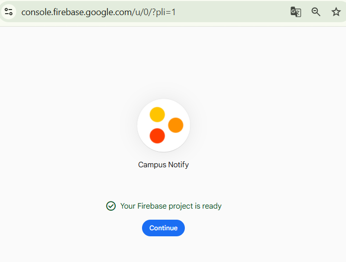 |
---

## 2. Minta izin notifikasi

Android 13+ dan iOS wajib meminta izin runtime. Buat lib/messaging/push_service.dart:

```dart
import 'package:firebase_messaging/firebase_messaging.dart';
import 'package:flutter_local_notifications/flutter_local_notifications.dart';

final _local = FlutterLocalNotificationsPlugin();

Future<bool> requestNotificationPermission() async {
  final settings =
      await FirebaseMessaging.instance.requestPermission(
    alert: true,
    badge: true,
    sound: true,
    announcement: false,
    carPlay: false,
    criticalAlert: false,
  );

  return settings.authorizationStatus ==
          AuthorizationStatus.authorized ||
      settings.authorizationStatus ==
          AuthorizationStatus.provisional;
}
```

Permission diperlukan terutama pada Android 13+ dan iOS.

---

## 3. Token lifecycle: ambil, kirim ke backend, pantau perubahan

```dart
Future<void> initLocalNotifications() async {
  const android =
      AndroidInitializationSettings('@mipmap/ic_launcher');

  const ios = DarwinInitializationSettings();

  await _local.initialize(
    const InitializationSettings(
      android: android,
      iOS: ios,
    ),
    onDidReceiveNotificationResponse: (response) {
      pendingDeepLink = response.payload;
    },
  );
}

String? pendingDeepLink;
```

Local notification digunakan agar aplikasi tetap dapat menampilkan notifikasi ketika berada pada kondisi foreground.

---

## 4. Token Lifecycle

FCM token tidak boleh dianggap permanen karena dapat berubah setelah reinstall, clear data, atau perubahan keamanan perangkat.

```dart
Future<void> initFcmToken({
  required Future<void> Function(String token) onToken,
}) async {
  final token =
      await FirebaseMessaging.instance.getToken();

  if (token != null) {
    await onToken(token);
  }

  FirebaseMessaging.instance.onTokenRefresh.listen(
    onToken,
  );

  await FirebaseMessaging.instance
      .subscribeToTopic('pengumuman-kampus');
}
```

Token kemudian dapat dikirim ke backend:

```dart
await initFcmToken(
  onToken: (token) async {
    await dio.post(
      '/devices',
      data: {
        'fcm_token': token,
        'platform': 'android',
      },
    );
  },
);
```
---

## Hasil Praktikum 2

| 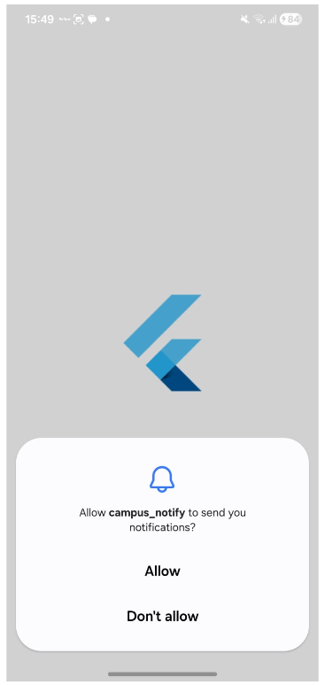          | 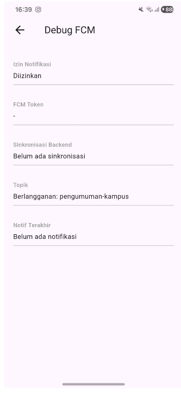    |

---
---

# Praktikum 3: Payload, App State, Deep Link dan Topic

---

## 1. Background handler wajib top-level

Handler background harus fungsi top-level (bukan method kelas) karena berjalan di isolate terpisah:

```dart
@pragma('vm:entry-point')
Future<void> firebaseMessagingBackgroundHandler(
  RemoteMessage message,
) async {
  // Tidak menggunakan BuildContext / Riverpod.
}

void registerBackgroundHandler() {
  FirebaseMessaging.onBackgroundMessage(
    firebaseMessagingBackgroundHandler,
  );
}
```

---

## 2. Tiga handler + contoh payload gabungan

Payload yang dikirim backend (contoh JSON via FCM HTTP v1):

```json
{
  "message": {
    "topic": "pengumuman-kampus",
    "notification": {
      "title": "Jadwal kuliah berubah",
      "body": "Kelas Mobile pindah ke Ruang A2 jam 13.00"
    },
    "data": {
      "route": "/pengumuman/3",
      "id": "3"
    }
  }
}
```


```dart
void listenForeground(
  void Function(String route) go,
) {
  FirebaseMessaging.onMessage.listen(
    (message) async {
      final route =
          message.data['route'] ?? '/';

      const androidDetails =
          AndroidNotificationDetails(
        'pengumuman',
        'Pengumuman Kampus',
        importance: Importance.high,
        priority: Priority.high,
      );

      await _local.show(
        message.hashCode,
        message.notification?.title ??
            'Pengumuman',
        message.notification?.body ?? '',
        const NotificationDetails(
          android: androidDetails,
        ),
        payload: route,
      );
    },
  );
}

Ketika aplikasi berada pada background dan pengguna menekan banner:

```dart
FirebaseMessaging.onMessageOpenedApp.listen(
  (message) {
    go(
      message.data['route'] ?? '/',
    );
  },
);

```dart
Future<void> handleTerminated(
  void Function(String route) go,
) async {
  final initial =
      await FirebaseMessaging.instance
          .getInitialMessage();

  if (initial != null) {
    go(
      initial.data['route'] ?? '/',
    );
  }

  if (pendingDeepLink != null) {
    go(pendingDeepLink!);
  }
}
```

---

### Hasil Praktikum

|  | 

---

# Topic Messaging

Topic digunakan untuk kebutuhan broadcast kepada banyak perangkat.

```dart
await FirebaseMessaging.instance
    .subscribeToTopic('pengumuman-kampus');

await FirebaseMessaging.instance
    .unsubscribeFromTopic('pengumuman-kampus');
```
# AI Challenge

## Peran AI pada Praktikum

AI digunakan sebagai coding assistant untuk membuat draft awal `PushService` dan boilerplate authentication.

Namun, hasil dari AI tetap diverifikasi secara manual karena beberapa bug pada sistem FCM tidak dapat diketahui hanya dengan membaca kode.

Contohnya:

* Token menjadi basi.
* Navigasi deep link salah.
* Banner notifikasi muncul dua kali.
* Background handler tidak berjalan.
* Token baru tidak dikirim kembali ke backend.

---

## Prompt yang Digunakan

```text
Aplikasi Flutter Campus Notification App.

Stack:
- firebase_messaging
- flutter_local_notifications
- flutter_secure_storage
- go_router
- Riverpod

Buatkan PushService dengan:
- requestPermission
- getToken
- onTokenRefresh yang mengirim token ke POST /devices
- onMessage untuk menampilkan local notification manual
- onMessageOpenedApp untuk navigasi ke data.route
- getInitialMessage untuk navigasi ketika aplikasi dibuka dari terminated state
- subscribe/unsubscribe topic pengumuman-kampus
- background handler top-level dengan @pragma('vm:entry-point')

Tandai bagian yang berbeda untuk Android 13+ dan iOS.

Tandai bagian yang tidak boleh mengakses BuildContext.
```

---

# AI Verification Checklist

* [x] Background handler berupa fungsi top-level dengan `@pragma('vm:entry-point')`.
* [x] `onTokenRefresh` digunakan untuk menangani perubahan token.
* [x] Foreground menggunakan local notification secara manual.
* [x] Deep link diuji pada foreground, background, dan terminated.
* [x] Token dan secret tidak di-hardcode.
* [x] Token tidak ditampilkan secara penuh pada screenshot.
* [x] Topic digunakan untuk kebutuhan broadcast.
* [x] Device token digunakan untuk pesan personal.

### Keputusan Final

Hasil dari AI tidak langsung diterima seluruhnya. Setiap bagian yang berkaitan dengan authentication, token lifecycle, notification lifecycle, dan deep linking tetap diuji secara manual.

Keputusan akhir diambil berdasarkan hasil implementasi dan pengujian aplikasi.

---

# Refactoring dan Testing

## Refactoring

Beberapa bagian aplikasi dipisahkan agar lebih mudah dipelihara.

### 1. Centralized Routes

String route dipusatkan pada satu file:

```text
lib/routes.dart
```

Contoh:

```dart
class AppRoutes {
  static const login = '/login';
  static const home = '/';
  static const announcement = '/pengumuman/:id';
}
```

Tujuannya agar deep link dari FCM dan GoRouter menggunakan sumber route yang sama.

---

## 2. Parsing Route

Parsing payload FCM dipisahkan ke fungsi murni:

```dart
String routeFromMessage(
  Map<String, String> data,
) {
  final route = data['route'] ?? '/';

  return route.startsWith('/')
      ? route
      : '/$route';
}
```

Fungsi tersebut dapat diuji tanpa Firebase.

---

## 3. Error Handling Dio

Pemetaan error API dipisahkan agar UI tidak menerima exception mentah.

Contoh kategori error:

```text
401        → Sesi berakhir
Timeout    → Koneksi terlalu lama
Offline    → Tidak ada koneksi internet
Unknown    → Terjadi kesalahan
```

---

# Unit Testing

Pengujian dilakukan tanpa Firebase sungguhan dengan menguji logika yang berada di sekitar Firebase.

### Contoh Test Route

```dart
test(
  'routeFromMessage menangani route kosong dan tanpa slash',
  () {
    expect(
      routeFromMessage({}),
      '/',
    );

    expect(
      routeFromMessage({
        'route': 'pengumuman/3',
      }),
      '/pengumuman/3',
    );

    expect(
      routeFromMessage({
        'route': '/pengumuman/3',
      }),
      '/pengumuman/3',
    );
  },
);
```

### Test Payload

```dart
test(
  'data payload membawa id pengumuman',
  () {
    const data = {
      'route': '/pengumuman/3',
      'id': '3',
    };

    expect(data['id'], '3');

    expect(
      routeFromMessage(data),
      '/pengumuman/3',
    );
  },
);
```

### Test Authentication

```dart
test(
  'provider auth membaca status login dari token',
  () async {
    final store =
        FakeTokenStore()..access = 'mock-access';

    expect(
      store.access != null,
      isTrue,
    );

    store.access = null;

    expect(
      store.access != null,
      isFalse,
    );
  },
);
```

### Test Refresh Token

```dart
test(
  'refresh gagal -> sesi dibersihkan',
  () async {
    final store =
        FakeTokenStore()..refresh = '';

    final needsLogin =
        (store.refresh ?? '').isEmpty;

    expect(
      needsLogin,
      isTrue,
    );
  },
);
```

---

# Menjalankan Testing

```bash
flutter analyze
flutter test
```

Hasil yang diharapkan:

```text
flutter analyze
No issues found.

flutter test
All tests passed.
```

# Tugas Praktikum / Mini Project

## Screenshot Hasil Tugas

| Login                                 | Home                                | Pengumuman                                      |
| ------------------------------------- | ----------------------------------- | ----------------------------------------------- |
| 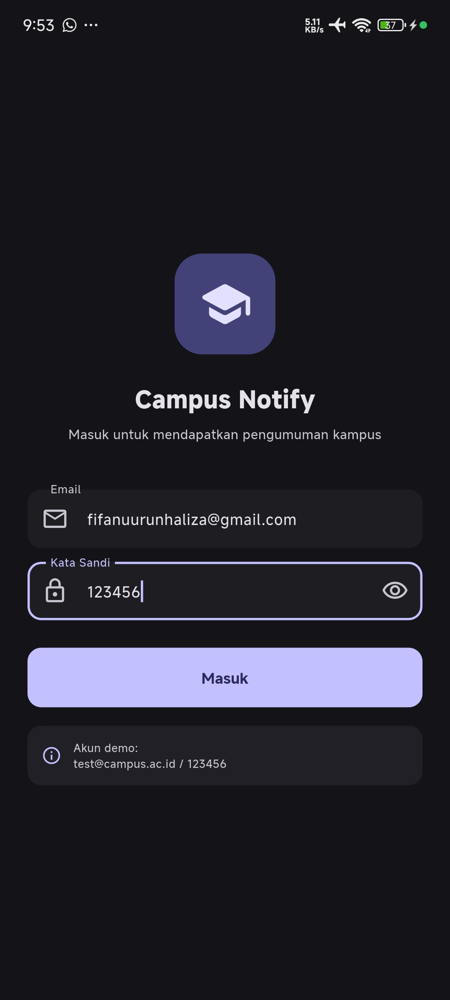 | 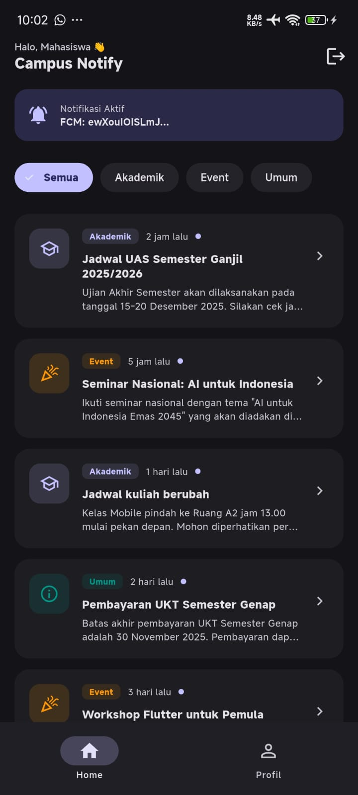 | 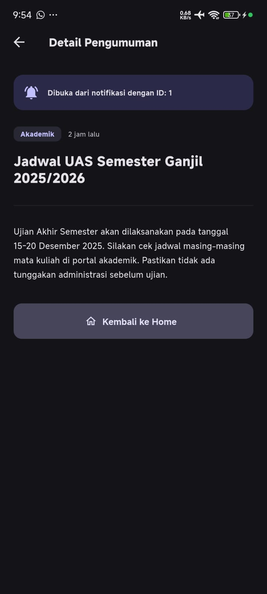 |

| FCM Permission                                  | FCM Token                             | Notification                                        |
| ----------------------------------------------- | ------------------------------------- | --------------------------------------------------- |
| 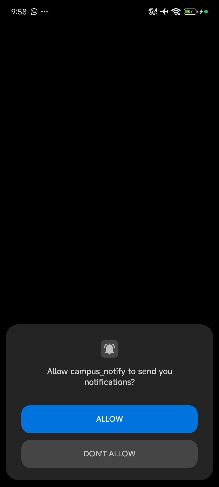 | 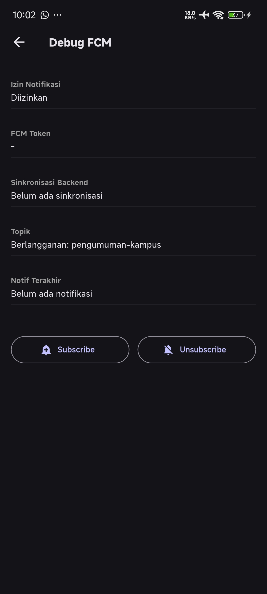 | 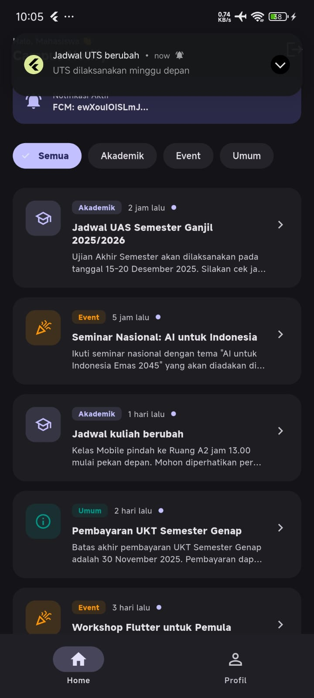 |


# Refleksi

### 1. Mengapa refresh token tidak boleh disimpan di SharedPreferences? Apa risikonya bila bocor?

Refresh token tidak boleh disimpan di SharedPreferences karena penyimpanan tersebut tidak terenkripsi — datanya berupa plain text yang bisa dibaca siapa pun yang punya akses ke sistem file. Karena refresh token berumur panjang dan bisa dipakai berkali-kali untuk memperoleh access token baru, jika bocor maka penyerang dapat mengambil alih akun dalam jangka panjang tanpa perlu tahu password. Risikonya meliputi akses tidak sah ke data pribadi, nilai, dan tagihan UKT. Solusinya: simpan di flutter_secure_storage yang memakai Android Keystore / iOS Keychain.

### 2. Apa yang rusak bila `onTokenRefresh` diabaikan selama satu semester?

Token FCM di backend akan menjadi basi (stale) karena token bisa berubah kapan saja akibat reinstall, clear data, atau rotasi otomatis Firebase. Backend yang masih memakai token lama akan gagal mengirim — server FCM mengembalikan UNREGISTERED — sehingga notifikasi tidak pernah sampai ke pengguna. Akibatnya pengumuman penting seperti perubahan jadwal, UAS, atau tagihan UKT bisa terlewat, dan aplikasi jadi tidak dapat diandalkan.

### 3. Kapan menggunakan topic dan kapan menggunakan device token?

Topic digunakan untuk pesan broadcast kepada kelompok pengguna.

Contohnya:

```text
pengumuman-kampus
```

Topic dapat digunakan untuk pengumuman seluruh mahasiswa atau kelompok tertentu.

Sebaliknya, device token digunakan untuk pesan yang bersifat personal, misalnya:

```text
Pemberitahuan nilai mahasiswa
Tagihan UKT
Informasi akun pribadi
```

Pesan personal tidak sebaiknya dikirim menggunakan topic karena topic ditujukan untuk broadcast.

### 4. Bagian mana dari draf AI yang diperbaiki?

Beberapa bagian draf AI diperbaiki: (a) background handler tanpa Firebase.initializeApp() — akan crash karena berjalan di isolate terpisah; (b) if (mounted) context.go(...) yang memicu warning use_build_context_synchronously — diganti dengan menyimpan ScaffoldMessenger sebelum await; (c) pemanggilan initFcmToken pada tombol Subscribe yang membuat listener onTokenRefresh menumpuk — dipisah jadi subscribeTopic(); (d) withOpacity() yang deprecated — diganti withValues(alpha:); (e) HomePage tanpa guard _pushStarted — ditambah flag agar startPush hanya jalan sekali. Semua diverifikasi manual di perangkat karena bug FCM tidak selalu terdeteksi oleh flutter analyze.

---