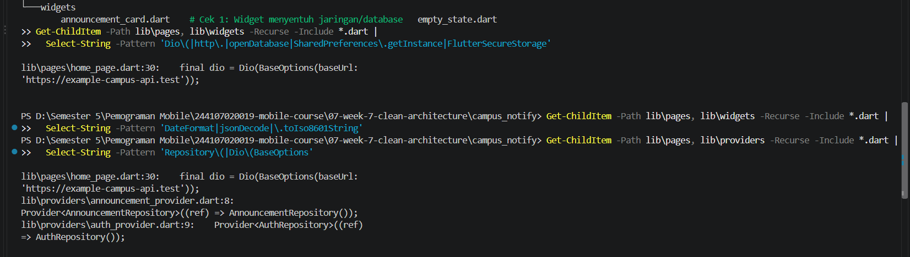
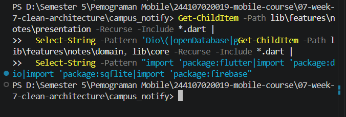
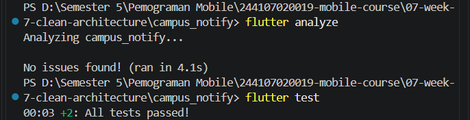
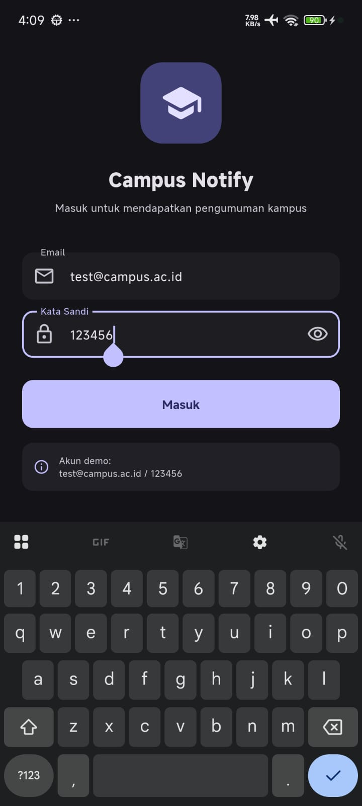
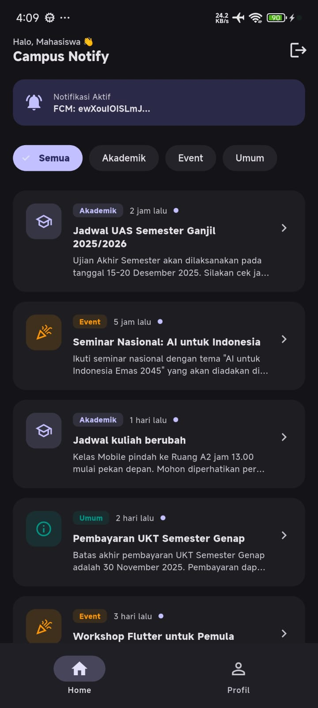
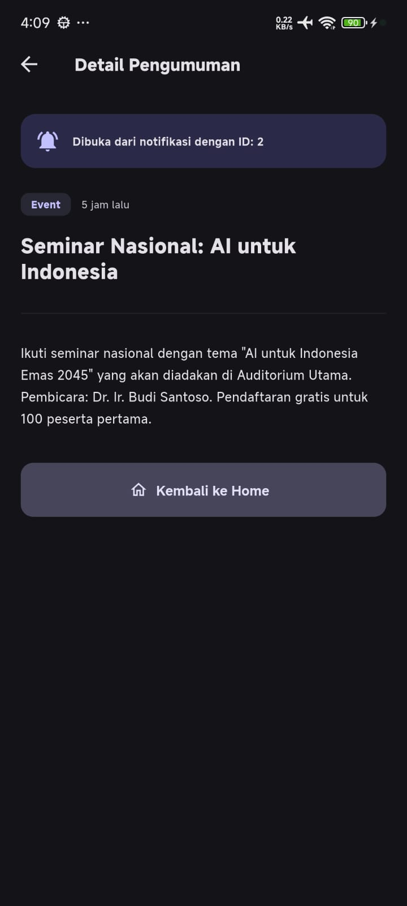

# Pemrograman Mobile
## Praktikum Week 6 - Authentication, Security & Firebase Cloud Messaging (FCM)

**Nama:** Fifa Nuuurn Halizah

**NIM:** 244107020019

**Kelas:** TI-3E  

# Praktikum 1: Audit layer project lama`

| File | Layer Saat Ini | Masalah |
|------|----------------|---------|
| `main.dart` | entry point | OK |
| `routes.dart` | routing | OK |
| `data/api_client.dart` | data | OK — hanya dipakai repository |
| `data/api_errors.dart` | data | OK, tapi error mapping tercampur dengan domain |
| `data/auth_repository.dart` | data |  Interface + implementasi tercampur dalam satu kelas |
| `data/announcement_repository.dart` | data |  Interface + implementasi tercampur |
| `data/token_store.dart` | data | OK |
| `messaging/push_service.dart` | data + presentation |  Status (ValueNotifier) & logika Firebase tercampur |
| `models/announcement.dart` | domain (tercampur) |  Entity masih punya `timeAgo` (formatting) & `copyWith` |
| `pages/home_page.dart` | presentation |  Memanggil `Dio()` langsung dari widget |
| `pages/login_page.dart` | presentation | OK |
| `pages/announcement_page.dart` | presentation | OK |
| `pages/debug_fcm_page.dart` | presentation | OK |
| `pages/main_shell.dart` | presentation | OK |
| `pages/profile_page.dart` | presentation | OK |
| `providers/announcement_provider.dart` | presentation (state) | OK, tapi pakai repository impl langsung |
| `providers/auth_provider.dart` | presentation (state) | OK |
| `providers/theme_provider.dart` | presentation (state) | OK |
| `theme/app_theme.dart` | presentation | OK |
| `widgets/announcement_card.dart` | presentation | OK |
| `widgets/empty_state.dart` | presentation | OK |

### Tiga Pelanggaran Klasik

1. **Widget menyentuh jaringan langsung** → `home_page.dart` memanggil `Dio(BaseOptions(...))`
2. **Entity bercampur formatting** → `models/announcement.dart` punya `timeAgo`
3. **Interface + implementasi tercampur** → `data/auth_repository.dart` dan `data/announcement_repository.dart`

## Hasil Tiga Grep Sterilitas (Sebelum Refactor)

### Cek 1: Widget menyentuh jaringan/database
\`\`\`powershell
Get-ChildItem -Path lib\pages, lib\widgets -Recurse -Include *.dart |
  Select-String -Pattern 'Dio\(|http\.|openDatabase|SharedPreferences\.getInstance|FlutterSecureStorage'
\`\`\`
**Hasil:**
\`\`\`
lib\pages\home_page.dart:30: final dio = Dio(BaseOptions(baseUrl: 'https://example-campus-api.test'));
\`\`\`

### Cek 2: Logika bisnis di dalam build()
\`\`\`powershell
Get-ChildItem -Path lib\pages, lib\widgets -Recurse -Include *.dart |
  Select-String -Pattern 'DateFormat|jsonDecode|\.toIso8601String'
\`\`\`
**Hasil:**
\`\`\`
(tidak ada hasil — bersih)
\`\`\`

### Cek 3: Instansiasi manual (DI bocor)
\`\`\`powershell
Get-ChildItem -Path lib\pages, lib\providers -Recurse -Include *.dart |
  Select-String -Pattern 'Repository\(|Dio\(BaseOptions'
\`\`\`
**Hasil:**
\`\`\`
lib\pages\home_page.dart:30: final dio = Dio(BaseOptions(baseUrl: 'https://example-campus-api.test'));
lib\providers\announcement_provider.dart:8: Provider<AnnouncementRepository>((ref) => AnnouncementRepository());
lib\providers\auth_provider.dart:9: Provider<AuthRepository>((ref) => AuthRepository());
\`\`\`

### Ringkasan
| Cek | Jumlah Pelanggaran | File Terdampak |
|-----|---------------------|----------------|
| 1 | 1 | `home_page.dart` |
| 2 | 0 | — |
| 3 | 3 | `home_page.dart`, `announcement_provider.dart`, `auth_provider.dart` |

**Target setelah refactor:** ketiganya **NOL hasil** di folder `presentation`.

|  |


### 3. Gambar struktur target

```text
Untuk satu fitur (notes atau announcements):

lib/
├── core/
│   ├── failures.dart        # Failure domain (murni Dart)
│   └── providers.dart       # (opsional) provider lintas fitur
├── features/
│   └── notes/
│       ├── domain/
│       │   ├── entities/note.dart
│       │   ├── repositories/note_repository.dart  # interface!
│       │   └── usecases/get_notes.dart
│       │   └── usecases/add_note.dart
│       ├── data/
│       │   ├── models/note_model.dart
│       │   └── repositories/note_repository_impl.dart
│       └── presentation/
│           ├── providers/notes_providers.dart     # notifier + DI
│           └── pages/notes_page.dart
└── routes.dart              # GoRouter + konstanta rute

---
```

# Praktikum 2: Domain dan Data per Fitur

## 1. Entity murni (domain)

Buat lib/features/notes/domain/entities/note.dart. Tanpa import Flutter, tanpa mapping:

```dart
class Announcement {
  const Announcement({
    required this.id,
    required this.title,
    this.body = '',
    this.category = 'Umum',
    required this.publishedAt,
  });

  final String id;
  final String title;
  final String body;
  final String category;
  final DateTime publishedAt;
}
```
### 2. Failure dan kontrak repository (domain)
Buat lib/core/failures.dart dan lib/features/notes/domain/repositories/note_repository.dart:
``` dart
sealed class Failure {
  const Failure(this.message);
  final String message;
}

class LocalFailure extends Failure {
  const LocalFailure(super.message);
}

class NetworkFailure extends Failure {
  const NetworkFailure(super.message);
}

class AuthFailure extends Failure {
  const AuthFailure(super.message);
}
```

### 3. Model dan implementasi (data)
Buat lib/features/notes/data/models/note_model.dart (mapping hanya di sini) dan note_repository_impl.dart:
```dart
import '../../domain/entities/note.dart';

class NoteModel extends Note {
  const NoteModel({
    super.id,
    required super.title,
    super.body = '',
    required super.updatedAt,
    super.dirty = false,
  });

  Map<String, Object?> toMap() => {
        'id': id,
        'title': title,
        'body': body,
        'updated_at': updatedAt.toIso8601String(),
        'dirty': dirty ? 1 : 0,
      };

  factory NoteModel.fromMap(Map<String, Object?> map) {
    return NoteModel(
      id: (map['id'] as num?)?.toInt(),
      title: map['title'] as String? ?? '',
      body: map['body'] as String? ?? '',
      updatedAt: DateTime.tryParse(map['updated_at'] as String? ?? '') ??
          DateTime.fromMillisecondsSinceEpoch(0),
      dirty: ((map['dirty'] as num?)?.toInt() ?? 0) == 1,
    );
  }

  Note toEntity() => Note(
        id: id,
        title: title,
        body: body,
        updatedAt: updatedAt,
        dirty: dirty,
      );
}

import 'package:sqflite/sqflite.dart';
import '../../../../core/failures.dart';
import '../../domain/entities/note.dart';
import '../../domain/repositories/note_repository.dart';
import '../models/note_model.dart';

class NoteRepositoryImpl implements NoteRepository {
  NoteRepositoryImpl({required Future<Database> Function() openDb})
      : _openDb = openDb;

  final Future<Database> Function() _openDb;

  @override
  Future<({List<Note> notes, Failure? failure})> fetchNotes() async {
    try {
      final db = await _openDb();
      final rows =
          await db.query('notes', orderBy: 'updated_at DESC');
      final notes =
          rows.map((r) => NoteModel.fromMap(r).toEntity()).toList();
      return (notes: notes, failure: null);
    } catch (e) {
      return (
        notes: const <Note>[],
        failure: LocalFailure('Gagal membaca catatan: $e'),
      );
    }
  }

  @override
  Future<({Note? note, Failure? failure})> addNote({
    required String title,
    String body = '',
  }) async {
    try {
      final db = await _openDb();
      final now = DateTime.now();
      final id = await db.insert(
        'notes',
        NoteModel(
            title: title, body: body, updatedAt: now, dirty: true)
            .toMap(),
      );
      return (
        note: Note(id: id, title: title, body: body,
            updatedAt: now, dirty: true),
        failure: null,
      );
    } catch (e) {
      return (note: null,
          failure: LocalFailure('Gagal menyimpan catatan: $e'));
    }
  }
}
```

---

## 4. Use case: satu operasi bisnis
Buat lib/features/notes/domain/usecases/get_notes.dart:
```dart
import '../../../../core/failures.dart';
import '../entities/note.dart';
import '../repositories/note_repository.dart';

class GetNotes {
  const GetNotes(this._repository);
  final NoteRepository _repository;

  Future<({List<Note> notes, Failure? failure})> call() {
    return _repository.fetchNotes();
  }
}


```

---

# Praktikum 3: Presentation, DI, dan Verifikasi

## 1. Dependency Injection dengan Riverpod

Seluruh wiring ketergantungan didefinisikan secara terpusat tanpa `new Repository()` di dalam widget.

**`lib/features/announcements/presentation/providers/announcement_providers.dart`**
```dart
final announcementRepositoryProvider = Provider<AnnouncementRepository>(
  (ref) => AnnouncementRepositoryImpl(),
);

final getAnnouncementsProvider = Provider<GetAnnouncements>(
  (ref) => GetAnnouncements(ref.watch(announcementRepositoryProvider)),
);

final announcementsProvider = FutureProvider<List<Announcement>>((ref) async {
  final r = await ref.watch(getAnnouncementsProvider).call();
  if (r.failure != null) throw Exception(r.failure!.message);
  return r.items;
});

// Category Filter Notifier (Riverpod 3.x compatible)
class CategoryNotifier extends Notifier<String> {
  @override
  String build() => 'Semua';
  void select(String value) => state = value;
}

final selectedCategoryProvider =
    NotifierProvider<CategoryNotifier, String>(CategoryNotifier.new);

final filteredAnnouncementsProvider =
    FutureProvider<List<Announcement>>((ref) async {
  final category = ref.watch(selectedCategoryProvider);
  final r = await ref.watch(getAnnouncementsProvider).call(category: category);
  if (r.failure != null) throw Exception(r.failure!.message);
  return r.items;
});

// Detail pengumuman langsung memanggil repository (tanpa use case over-engineering)
final announcementDetailProvider =
    FutureProvider.family<Announcement?, String>((ref, id) async {
  final r = await ref.watch(announcementRepositoryProvider).fetchById(id);
  if (r.failure != null) throw Exception(r.failure!.message);
  return r.item;
});
```

---

## 2. Halaman Murni Presentation

`HomePage` dan `AnnouncementPage` hanya membaca state dari Riverpod dan tidak mengandung query SQL, Dio HTTP, atau formatting tanggal mentah:

```dart
// Pola konsumsi di HomePage
final announcementsAsync = ref.watch(filteredAnnouncementsProvider);

announcementsAsync.when(
  loading: () => const Center(child: CircularProgressIndicator()),
  error: (err, _) => Center(child: Text('Gagal: $err')),
  data: (items) => ListView.builder(
    itemCount: items.length,
    itemBuilder: (_, i) => AnnouncementCard(item: items[i]),
  ),
);
```

---

## 3. Verifikasi Dependency Rule (Grep Sterilitas AFTER)

Tiga pemeriksaan sterilitas dijalankan pada seluruh codebase setelah refactor:

```bash
# 1. Presentation steril dari data mentah & database
grep -rnE "Dio\(|openDatabase|getDatabasesPath|FlutterSecureStorage|SharedPreferences\.getInstance|jsonDecode" lib/features/*/presentation lib/pages

# 2. Domain & core steril dari framework eksternal
grep -rnE "import 'package:(flutter|dio|sqflite|firebase)" lib/features/*/domain lib/core

# 3. Presentation steril dari instansiasi manual (DI bocor)
grep -rnE "Repository\(|Dio\(BaseOptions" lib/features/*/presentation
```

**Hasil: 0 temuan (NOL HASIL) pada ketiga pemeriksaan.** Seluruh layer terbukti steril dan mematuhi aturan Clean Architecture!

|  |

---

# AI Challenge & Refactoring Challenge

## 1. AI Prompt Challenge
Dokumentasi lengkap AI Challenge disimpan di folder `docs/`:
* [`docs/ai-prompt.md`](docs/ai-prompt.md): Prompt analisis arsitektur awal.
* [`docs/ai-output.md`](docs/ai-output.md): Rekomendasi awal model AI.
* [`docs/ai-decision-table.md`](docs/ai-decision-table.md): Tabel keputusan teknis dan trade-off.
* [`docs/ai-verification.md`](docs/ai-verification.md): Checklist verifikasi 5 poin.

## 2. Tabel Usulan AI vs Keputusan Final

| Usulan Awal AI | Keputusan Final | Alasan Teknis & Trade-off |
| :--- | :--- | :--- |
| Membuat Use Case untuk setiap operasi (termasuk `fetchById` dan `logout`) | Hanya membuat Use Case untuk `GetAnnouncements` dan `Login`. `fetchById` langsung dipanggil dari Provider. | Operasi `fetchById` hanya 1 baris pembacaan data tanpa logika bisnis tambahan. Membuat use case terpisah adalah **over-engineering** yang menambah kompleksitas tanpa keuntungan nyata. |
| Meletakkan `api_client.dart` di `lib/core/` | Memindahkan `api_client.dart` ke `lib/shared/data/`. | Folder `lib/core/` harus murni Dart. Mengimpor `dio` di dalam `core/` melanggar aturan sterilitas dependensi. |
| Menambahkan pustaka DI eksternal (`get_it`) | Menggunakan bawaan **Riverpod**. | Riverpod sudah menyediakan container DI deklaratif yang aman saat kompilasi tanpa perlu dependensi tambahan. |
| Menggunakan `StateProvider` untuk filter UI | Menggunakan `NotifierProvider` dengan `CategoryNotifier`. | Pada versi Riverpod 3.x, `StateProvider` telah deprecated/dihapus. |

## 3. AI Verification Checklist
- [x] Interface repository berada di `domain` dan implementasi di `data`.
- [x] Domain dan core 100% bebas import Flutter / Dio / SQLite / Firebase.
- [x] Tidak ada use case berlebihan untuk operasi CRUD satu-baris.
- [x] Entity bebas mapping (`fromJson` hanya ada di Model).
- [x] Wiring DI terpusat di provider, widget tidak pernah melakukan `new Repository()`.

---

# Unit Testing & Verifikasi Statis

Pengujian domain dilakukan secara murni tanpa framework UI, emulator, database, maupun jaringan internet:
* `test/get_announcements_test.dart`: Menguji logika pengurutan tanggal terbaru, filtering kategori, dan propagasi Failure menggunakan `FakeAnnouncementRepository`.
* `test/auth_push_test.dart`: Menguji pemetaan route murni `routeFromMessage`, validasi kredensial login, interceptor token refresh 401, dan pembersihan sesi saat refresh gagal.

### Bukti Pengujian & Analisis:
\
|  | 

---

# Hasil UI 

| **Login Page** |  |
| **Home Page (Announcements)** |  || **Detail Pengumuman** |  |

---


---

# Checklist Verifikasi Mandiri

* [x] Struktur folder feature-first (`features/announcements`, `features/auth`, `core`, `shared`).
* [x] Interface repository berada di domain, implementasi berada di data.
* [x] Entity murni bisnis tanpa metode serialisasi JSON/Map.
* [x] Mapping data (`fromJson`/`toEntity`) hanya ada di layer data model.
* [x] Widget tidak menginstansiasi repository/Dio secara manual (DI via Riverpod).
* [x] Tiga grep sterilitas (presentation & domain) menghasilkan 0 temuan.
* [x] Tampilan aplikasi berjalan identik sebelum dan sesudah refactor.
* [x] `flutter analyze` bersih tanpa issue (`No issues found!`).
* [x] Seluruh unit test lulus (`All tests passed!`).
* [x] Folder `docs/` berisi dokumentasi AI Challenge lengkap.
---

# Refleksi

### 1. Mengapa interface repository harus tinggal di domain, bukan di data? Apa yang rusak bila dibalik?
Jika interface ditaruh di layer data, maka layer domain harus mengimpor layer data untuk memanggil kontrak tersebut. Hal ini melanggar **Dependency Inversion Principle** dan **Aturan Dependensi Clean Architecture** (arah panah dependensi menjadi terbalik: *domain bergantung pada data*). Akibatnya, logika bisnis menjadi terikat pada detail implementasi luar, dan domain tidak lagi dapat diuji secara independen tanpa mengikutsertakan library data.

### 2. Kapan use case benar-benar dibutuhkan, dan kapan repository langsung ke notifier sudah cukup?
Use case benar-benar dibutuhkan ketika sebuah operasi melibatkan **aturan bisnis** (misalnya validasi input kompleks, kombinasi data dari lebih dari satu repository, sorting/filtering kustom, atau transformasi data). Sebaliknya, untuk operasi CRUD sederhana satu baris (seperti mengambil detail entitas berdasarkan ID), memanggil repository langsung dari notifier sudah cukup agar tidak menimbulkan boilerplate berlebihan.

### 3. Apa biaya over-engineering (use case per CRUD satu-baris) bagi tim kecil? Kapan biayanya sepadan?
Biaya over-engineering adalah bertambahnya jumlah file, kode boilerplate, dan waktu navigasi kode yang memperlambat laju pengembangan fitur baru bagi tim kecil. Biaya tersebut baru sepadan ketika aplikasi berskala besar dengan banyak anggota tim yang bekerja paralel, atau saat aturan bisnis pada operasi tersebut sering berubah-ubah dan memerlukan unit test tersendiri.

### 4. Bagian mana dari usulan AI yang Anda tolak atau sederhanakan, dan mengapa?
Saya menolak usulan AI untuk membuat use case pada setiap operasi (seperti `fetchById` dan `logout`) karena keduanya hanya meneruskan pemanggilan repository satu baris tanpa aturan bisnis. Selain itu, saya menolak usulan menaruh `api_client` di `core/`, karena `core/` harus murni Dart agar lulus uji sterilitas grep terhadap package `dio`.