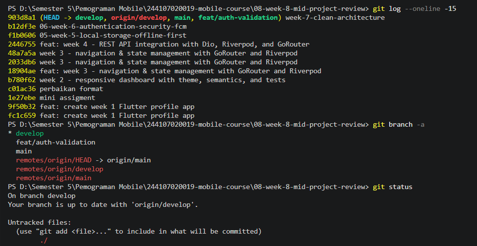
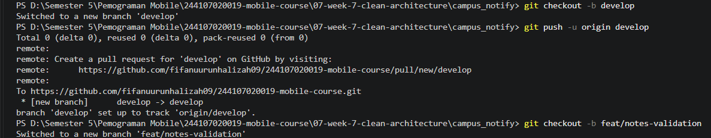
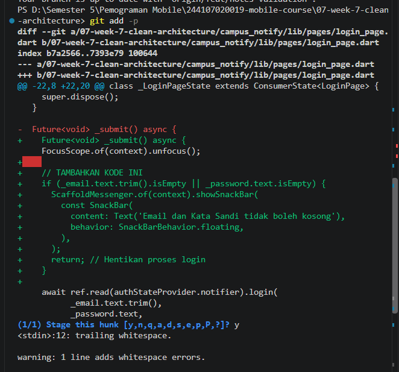
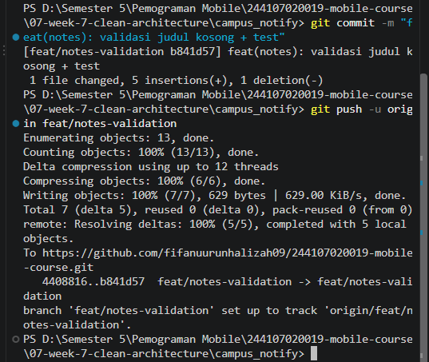
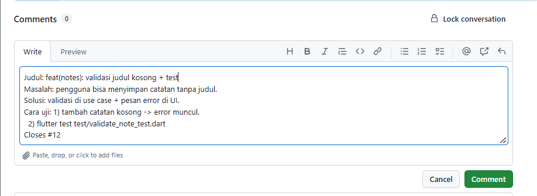
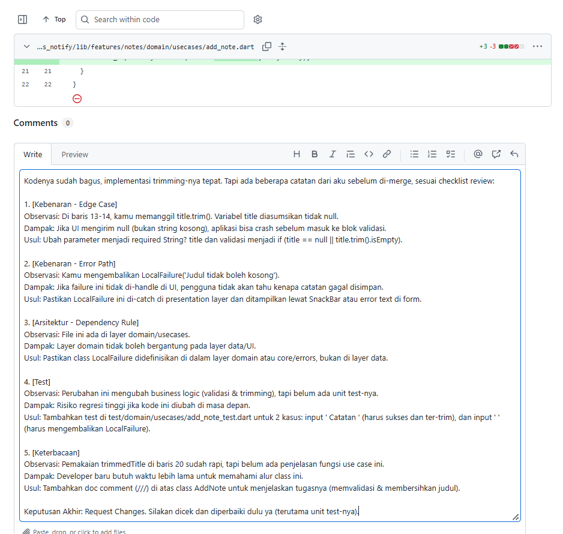
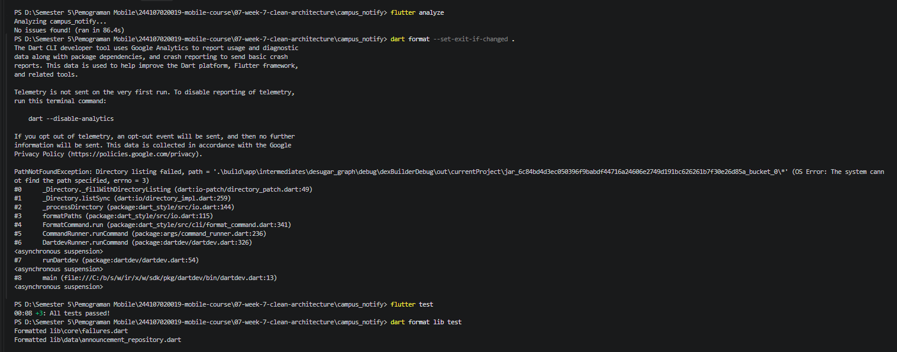

# Week 8 — Mid-Project Review

**Nama:** Fifa Nuurun Halizah | **Kelas:** T1-3E | **NIM:** 244107020019

## Gambaran Umum

Week 8 adalah evaluasi tengah semester untuk repository portfolio yang dikembangkan pada Minggu 5–7. Kegiatan berfokus pada disiplin Git, Pull Request (PR), peer review, static analysis, testing, refactoring, dan verifikasi hasil review AI. Minggu ini melanjutkan project yang sudah ada, bukan membuat project baru.

Latihan perubahan kecil menggunakan branch `feat/notes-validation` dengan fokus validasi judul catatan. Review AI dan keputusan teknisnya dicatat terpisah di [`docs/ai-review-vs-keputusan.md`](docs/ai-review-vs-keputusan.md).

## Tujuan

- Menjaga `main` tetap terlindungi dan mengerjakan perubahan melalui branch singkat.
- Membuat commit kecil dengan pesan yang menjelaskan perubahan.
- Mengajukan PR yang terfokus, lengkap dengan cara uji dan bukti.
- Memberi review yang bisa ditindaklanjuti, lalu memperbaiki dan meminta review ulang.
- Menjalankan formatter, analyzer, dan test secara lokal maupun melalui CI.
- Memverifikasi saran AI menggunakan bukti kode dan hasil pemeriksaan, bukan menerimanya secara otomatis.

## Praktikum 1 — Hygiene Branch dan Commit

### Audit repository

Jalankan perintah berikut dari repository project Minggu 5–7:

```bash
git log --oneline -15
git branch -a
git status
```


Tandai commit langsung ke `main`, pesan commit yang tidak informatif seperti `fix bug` atau `update`, branch yang tidak aktif lebih dari satu minggu, dan file yang seharusnya di-commit atau dimasukkan ke `.gitignore`.

### Alur branch kerja

Jangan mengerjakan perubahan langsung di `main`. Sinkronkan `develop`, lalu buat branch pendek untuk satu perubahan logis:

```bash
git switch develop
git pull origin develop
git switch -c feat/notes-validation
```


```bash
# Kerjakan satu perubahan kecil, lalu tinjau file yang berubah.
git status
git add -p
git commit -m "feat(notes): validasi judul kosong + test"
git push -u origin feat/notes-validation
```



Gunakan `git add -p` agar satu commit hanya memuat satu perubahan logis. Hindari memasukkan file build, konfigurasi lokal, atau perubahan lain yang tidak terkait.

### Perbaikan pesan commit (simulasi)

Tiga pesan lama beserta perbaikannya dan alasannya dicatat dalam [`docs/review-checklist.md`](docs/review-checklist.md). Contoh format yang digunakan:

Contoh: `feat(notes): cegah simpan judul kosong + test`.

## Praktikum 2 — Pull Request dan Peer Review

### Membuka PR kecil

Buka PR dari `feat/notes-validation` ke `develop`. Isi PR harus menerangkan masalah, solusi, cara pengujian, screenshot yang relevan, dan issue yang ditutup. Contoh template:

```text
Judul: feat(notes): validasi judul kosong + test

Masalah:
Pengguna dapat menyimpan catatan tanpa judul.

Solusi:
Validasi judul dan tampilkan pesan error di UI.

Cara uji:
1. Tambah catatan dengan judul kosong — error muncul.
2. Jalankan flutter test test/validate_note_test.dart.

Screenshot:
Lampirkan hasil validasi atau pengujian.

Closes #12
```

Sesuaikan nomor issue, nama test, dan screenshot dengan perubahan yang benar-benar dibuat; jangan mencantumkan bukti yang belum tersedia.



### Review sejawat

Tukar PR dengan pasangan dan lakukan review sekitar 15 menit. Review minimal mencakup:

- 2 temuan kebenaran: misalnya null/state, jalur error, atau edge case.
- 1 temuan arsitektur: misalnya dependency lintas layer, DI, atau model yang bocor ke UI.
- 1 temuan test dan 1 saran keterbacaan.
- Keputusan akhir: **Approve** atau **Request changes**.

Tulis komentar dengan pola **observasi → dampak → usulan konkret**. Contoh:

```text
Observasi: fungsi ini memuat 60 baris dan 3 tanggung jawab.
Dampak: validasi sulit diuji terpisah dari widget.
Usulan: pindahkan validasi ke core/validate_note.dart
agar bisa diuji tanpa widget.
```

Komentar harus jelas dan dapat ditindaklanjuti tanpa reviewer perlu menjelaskan ulang. Bersikap tegas pada kode dan tetap menghargai orangnya.

### Tindak lanjut

Author memperbaiki komentar berstatus *request changes*, meminta review ulang, lalu menggabungkan PR setelah mendapat approval dan pemeriksaan CI lulus. Gunakan squash bila commit perantara tidak memberi nilai, pastikan issue tertutup otomatis, dan hapus branch setelah merge.



## Praktikum 3 — Static Analysis dan Mid-Project Review

### Pemeriksaan lokal

Jalankan dari root aplikasi Flutter. Ketiga perintah harus berhasil sebelum PR diminta untuk direview:

```bash
flutter analyze
dart format --set-exit-if-changed .
flutter test
```


Perbaiki error sebelum warning. Contoh tindak lanjut: hapus import yang tidak digunakan, gunakan `const` bila sesuai, dan periksa ulang perubahan formatter. Jangan mengklaim hasil hijau sebelum perintah benar-benar dijalankan.

### CI untuk Pull Request

Workflow repository pada [`.github/workflows/ci.yml`](../.github/workflows/ci.yml) menjalankan `flutter analyze` dan `flutter test` pada aplikasi `05-week-5-local-storage-offline-first/week5_offline_notes` setiap PR. File workflow berada di root repository agar terdeteksi oleh GitHub Actions. PR yang gagal pemeriksaan otomatis harus diperbaiki sebelum merge.

### Nilai Kesiapan Tengah Semester
(../.docs/review-checklist.md) 

### Definisi selesai dan bukti

Mid-project review dinyatakan siap jika:

- Aplikasi berjalan dengan hasil yang konsisten dengan akhir Minggu 7.
- Pemeriksaan tiga mesin lokal lulus: `flutter analyze`, `dart format`, dan `flutter test`.
- Minimal satu PR kecil per pasangan telah melewati review dan di-merge.
- README menjelaskan status project, fitur utama, stack, cara menjalankan, dan peta issue/PR.
- Screenshot dan hasil pemeriksaan tersedia di `screenshots/`.
- Komentar review yang diterima sudah ditindaklanjuti.

Yang dinilai adalah fondasi project yang dapat dipercaya untuk paruh semester berikutnya, bukan banyaknya fitur.

## AI Challenge — Review dengan Verifikasi

AI boleh menjadi reviewer awal, tetapi developer tetap menentukan keputusan. Contoh prompt:

```text
Review PR Flutter ini sebagai senior Flutter dev.
Konteks: feature-first Clean Architecture (presentation -> domain <- data),
Riverpod, GoRouter, SQLite + Dio.
Fokus: kebenaran, arsitektur, dan test. Abaikan style.
Berikan 5 temuan teratas + level (blocker/saran),
alasan, dan usulan potongan kode perbaikan.
```

Sebelum menerima atau menolak temuan, catat verifikasi di [`docs/ai-review-vs-keputusan.md`](docs/ai-review-vs-keputusan.md):

- Buktikan temuan menggunakan kode, grep, test yang gagal, atau reproduksi manual.
- Periksa apakah saran melanggar aturan dependency (domain tidak mengimpor Flutter, Dio, atau SQLite).
- Bedakan masalah perilaku/arsitektur dari style yang semestinya ditangani formatter atau CI.
- Dokumentasikan minimal 2 temuan AI yang terbukti dan minimal 1 temuan yang ditolak beserta alasannya.
- Catat keputusan teknis akhir, termasuk bila berbeda dari saran AI.

Simpan prompt, output awal, tabel usulan-versus-keputusan, serta bukti test/analyze di `docs/`. Saat demo, setiap keputusan harus dapat dijelaskan tanpa bergantung pada catatan AI.

## Refactoring, Testing, dan Penanganan Error

### Tantangan refactoring

1. Tindak lanjuti seluruh komentar *request changes* dan minta re-review hingga mendapat approval.
2. Pindahkan temuan style berulang ke formatter atau CI agar tidak menghabiskan waktu review.
3. Pecah PR besar (lebih dari 300 baris) menjadi 2–3 PR kecil yang masing-masing dapat direview dalam waktu kurang dari 15 menit.

### Testing wajib untuk perubahan perilaku

Setiap PR yang mengubah perilaku menyertakan bukti pengujian:

```bash
flutter analyze
flutter test
```

Tambahkan langkah uji manual dan screenshot bila alur UI perlu dibuktikan. PR yang belum dijalankan test belum layak di-approve.

### Error umum

| Gejala | Penyebab umum | Solusi |
|---|---|---|
| PR 800 baris sulit direview | Banyak fitur digabung dalam satu PR | Pecah per fitur; targetkan satu PR kurang dari 300 baris |
| Konflik merge berulang | Branch lama dan jarang disinkronkan | Sinkronkan dengan `develop` setiap hari; jaga umur branch kurang dari 3 hari |
| Review hanya membahas spasi | Tidak ada formatter atau CI | Wajibkan `dart format` dan CI `flutter analyze` |
| Approve tetapi bug lolos | Reviewer tidak checkout dan menjalankan test | Reviewer checkout branch, jalankan aplikasi/test, dan uji manual |
| Saran AI merusak arsitektur | Output AI diterima tanpa verifikasi | Tolak dengan alasan teknis dan bukti grep/test |

### Checklist verifikasi mandiri

- [ ] Branch dibuat dari `develop`; PR hanya memuat satu fitur dan issue terhubung.
- [ ] Minimal 3 komentar review bermakna telah ditindaklanjuti hingga approval.
- [ ] `flutter analyze` bersih, `dart format` rapi, dan `flutter test` lulus.
- [ ] Keputusan review AI didokumentasikan di `docs/`.
- [ ] Screenshot dan bukti pemeriksaan disimpan di `screenshots/`.

## Tugas Mini Project / Industry Challenge

Lanjutkan repository portfolio Minggu 5–7; jangan membuat project baru. Lengkapi hal berikut:

1. Buat minimal 1 issue dan 1 PR kecil dari `feature/*` ke `develop`, lalu merge melalui review sejawat.
2. Gunakan template PR berisi masalah, solusi, cara uji, dan screenshot.
3. Cantumkan hasil `flutter analyze` dan `flutter test` yang benar-benar dijalankan.
4. Dokumentasikan prompt AI, tabel usulan-versus-keputusan final, serta bukti penerimaan/penolakan di `docs/`.
5. Siapkan folder portfolio `08-week-8-mid-project-review/` dengan `docs/`, `screenshots/`, dan README ini.

README portfolio menjelaskan status paruh semester, peta issue/PR, fitur utama, stack teknologi, cara menjalankan aplikasi, dan hasil yang dicapai.

## Refleksi

### 1. Apa beda LGTM buta dengan approve yang bertanggung jawab?

LGTM buta diberikan tanpa memeriksa diff, perilaku, dan hasil test. Approve yang bertanggung jawab diberikan setelah reviewer memahami perubahan dan memeriksa risikonya. LGTM buta dapat membawa bug ke `develop`, menambah utang teknis, dan membuat masalah terlambat diketahui.

### 2. Kapan komentar perlu *Request changes*, dan kapan cukup menjadi saran?

Gunakan *Request changes* untuk bug, perilaku yang tidak sesuai kebutuhan, pelanggaran arsitektur, atau syarat wajib yang belum terpenuhi. Saran cukup untuk perbaikan non-blocking seperti keterbacaan atau penyederhanaan yang tidak mengubah kebenaran fitur.

### 3. Bagian mana dari review AI yang ditolak atau disederhanakan, dan mengapa?

Tidak semua saran AI diterapkan otomatis. Catat saran yang diterima maupun ditolak, alasan teknisnya, serta bukti verifikasinya di [`docs/ai-review-vs-keputusan.md`](docs/ai-review-vs-keputusan.md). Contohnya, `trim()` dapat tepat untuk memeriksa string whitespace tanpa harus mengubah nilai yang ditampilkan; keputusan tetap bergantung pada konteks kode dan requirement.

### 4. Apa satu perbaikan konkret setelah review sejawat dan dampaknya?

Dokumentasikan satu komentar yang benar-benar ditindaklanjuti, perubahan yang dibuat, dan dampaknya terhadap perilaku atau test. Hindari klaim perbaikan tanpa merujuk PR atau bukti yang sesuai.

## Struktur Folder

```text
repository-root/
└── 08-week-8-mid-project-review/
    ├── .github/
    │   └── workflows/
    │       └── ci.yml
    ├── docs/
    │   ├── ai-review-vs-keputusan.md
    │   └── review-checklist.md
    ├── screenshots/
    └── README.md
