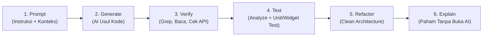

# Laporan Praktikum Minggu 9: AI-Assisted Development (Vibe Coding)

**Nama:** Fifa Nuurun Halizah  
**NIM:** 244107020019  
**Kelas: TI-3E** 

---

## 1. Ringkasan & Tujuan Pembelajaran

Praktikum Minggu 9 menekankan paradigma **AI-assisted development** yang bijak dan terstruktur (*bukan vibe coding serampangan*). Mahasiswa diarahkan untuk memanfaatkan AI sebagai akselerator kode awal (*scaffolding/generator*), namun tetap memegang kendali penuh melalui siklus: **Prompt $\rightarrow$ Generate $\rightarrow$ Verify $\rightarrow$ Test $\rightarrow$ Refactor $\rightarrow$ Explain**.

### Tujuan Pembelajaran:
1. Menjelaskan workflow *AI-assisted development* (`prompt`, `generate`, `verify`, `test`, `refactor`, `explain`).
2. Menulis prompt dan konteks yang presisi untuk fitur Flutter kecil menggunakan **Formula 5 Slot**.
3. Mengenali dan membuktikan halusinasi serta keterbatasan AI pada ekosistem Flutter.
4. Melakukan *debugging* dan *refactoring* kode usulan AI agar patuh pada prinsip *Clean Architecture*.
5. Menguji kode secara objektif dengan *green engine verification* (`flutter analyze`, unit test, dan widget test).
6. Mendokumentasikan prompt, respon AI, tabel keputusan terima/tolak, dan bukti uji secara rapi di [`docs/ai-log.md`](docs/ai-log.md).

---

## 2. Konsep Workflow AI & Pencegahan Halusinasi



> **Prinsip Verifikasi:** Klaim atau kode dari AI hanyalah hipotesis sampai ada bukti nyata berupa autocompletion valid, `flutter analyze` nol warning, dan unit/widget test bernilai hijau (lulus).

### Kemampuan & Keterbatasan AI
| Area | Contoh | Sikap Developer |
| :--- | :--- | :--- |
| **Kuat** | *Boilerplate*, pola umum, draf unit test, dokumentasi markdown. | Manfaatkan untuk percepatan, tetap uji secara objektif. |
| **Lemah** | API paket versi mutakhir, logika bisnis spesifik, struktur *unmodifiable*. | Verifikasi ekstra via pub.dev, `pubspec.lock`, dan test. |
| **Berbahaya** | Secret token, JWT, API key, kredensial auth, query SQL mentah. | **Dilarang menempel secret ke AI**; gunakan placeholder dan tulis manual. |

---

## 3. Praktikum 1: Prompt & Context Engineering

### A. Formula 5 Slot
Prompt dirancang secara terstruktur dengan mengisi kelima slot:

```text
Peran   : Senior Flutter Developer
Konteks : Arsitektur feature-first (presentation -> domain <- data), model Note { id, title, body },
          file target lib/features/notes/domain/filter_notes.dart, pure Dart tanpa I/O.
Tugas   : Implementasikan fungsi pencarian judul notes (filter) case-insensitive + penanganan empty state.
Batas   : Jangan ubah arsitektur, jangan impor Flutter/Dio/SQLite di domain, maks 40 baris.
Output  : Kode filter_notes.dart + 3 unit test + instruksi cara uji terminal.
```

### B. Perbandingan Prompt: Buruk vs Baik
*  **Prompt Buruk (Kabur & Tanpa Batas):**
   > *"Buatkan search notes yang keren dong di Flutter!"*  
  *(Akibat: AI menghasilkan widget monolith 200 baris yang mencampur logika SQLite, state management, dan UI secara acak).*
* **Prompt Baik (5 Slot & Berkonteks):**
  > *"Tambah search judul notes. Arsitektur: presentation->domain<-data. Jangan panggil SQLite dari widget. Sertakan empty state + 1 widget test."*  
  *(Hasil: Kode bersih, fungsi domain terisolasi, dan mudah diuji secara otomatis).*

### C. Keamanan & Kerahasiaan (Zero-Secret Policy)
Dalam praktikum ini, seluruh token otentikasi, API keys, dan data sensitif diganti menggunakan *placeholder* (misal `TOKEN_PLACEHOLDER`) sebelum dikirimkan ke model AI.

---

## 4. Praktikum 2: Generate & Verifikasi Search

### A. Kode Hasil AI di Domain Layer (`lib/features/notes/domain/filter_notes.dart`)
```dart
import 'note.dart';

List<Note> filterNotes(List<Note> notes, String query) {
  final normalizedQuery = query.trim().toLowerCase();
  if (normalizedQuery.isEmpty) {
    return List<Note>.unmodifiable(notes);
  }

  return notes
      .where((note) => note.title.toLowerCase().contains(normalizedQuery))
      .toList(growable: false);
}
```

### B. Verifikasi 6 Langkah
1. **Baca Tiap Baris:** Memastikan logika `.trim()` membuang spasi liar, `.toLowerCase()` menyamakan case, dan `contains()` melakukan substring matching.
2. **Cek Import:** File `filter_notes.dart` hanya mengimpor `note.dart` (murni domain, nol dependensi luar).
3. **Cek API:** Validasi method bawaan Dart melalui autocomplete IDE.
4. **Jalankan `flutter analyze`:** Bebas dari issue dan warning.
5. **Uji Test Sukses & Gagal:** Disiapkan skenario test case pencarian cocok, pencarian query kosong, dan pencarian tidak cocok (*empty list*).
6. **Uji Manual:** Menjalankan antarmuka pada input kosong, pencarian kata kunci cocok, dan kata kunci acak.

---

## 5. Praktikum 3: Debug & Refactoring

### A. Siklus Debugging Red-to-Green
1. **Reproduksi:** Saat AI men-generate draf awal test, AI mengimpor package halusinasi `package:your_app_name/...` dan membiarkan typo penutup kurung `}g` pada file UI `notes_page.dart`.
2. **Isolasi:** Mengidentifikasi nama package proyek pada `pubspec.yaml` yaitu `week_9` dan mendeteksi syntax error pada `notes_page.dart`.
3. **Test Merah:** `flutter analyze` dan `flutter test` gagal kompilasi (merah) membuktikan kesalahan tersebut.
4. **Perbaiki Kecil:** Memperbaiki URI import ke `package:week_9/...` dan membuang karakter liar `g`.
5. **Verifikasi:** Menjalankan ulang `flutter analyze` dan `flutter test` hingga kembali hijau (*clean*).

### B. Refactoring ke Clean Architecture
Struktur presentation dipecah agar method `build()` berukuran ramping (< 30 baris) dan tidak menumpuk:
- `_buildSearchField()`: Mengisolasi TextField pencarian.
- `_buildEmptyState()`: Menampilkan state kosong saat query tidak cocok.
- `_buildNotesList()`: Me-render ListView kumpulan catatan.

```text
Widget (UI Saja)           -> lib/features/notes/presentation/notes_page.dart
State Notifier / Local     -> _searchQuery state di _NotesPageState
Use Case (Aturan Filter)   -> lib/features/notes/domain/filter_notes.dart
Repository Contract        -> lib/features/notes/domain/note_repository.dart
```

---

## 6. AI Challenge: Senior Dev Code Review & Evaluasi

### A. Prompt Review Senior Dev
```text
Review kode search Flutter ini sebagai senior dev.
Konteks: feature-first (presentation->domain<-data), Riverpod, SQLite + Dio.
Fokus: kebenaran, arsitektur, test. Abaikan style.
Beri 3 temuan + level blocker/saran + alasan.
```

### B. Tabel Usulan AI vs Keputusan Developer

| No | Temuan & Usulan AI | Level | Keputusan | Alasan Teknis & Bukti |
|:---|:---|:---|:---|:---|
| 1 | **Pecah fungsi `build` presentation menjadi sub-widget terpisah (< 40 baris).** | Saran Arsitektur | **DITERIMA** | Fungsi `build()` awal berukuran lebih dari 60 baris. Dipecah menjadi method modular `_buildSearchField`, `_buildEmptyState`, dan `_buildNotesList` agar readable dan terisolasi. |
| 2 | **Kunci hasil filter dengan `List<Note>.unmodifiable` / `growable: false`.** | Blocker Keamanan | **DITERIMA** | Menjamin immutability sehingga layer presentasi tidak dapat memutasi data catatan domain secara tidak sengaja. |
| 3 | **Pindahkan proses filtering ke query SQLite `WHERE title LIKE ?` sekarang juga.** | Saran Teknis | **DITOLAK** | Dataset catatan lokal bersifat in-memory dan ringkas. Filter di domain pure Dart jauh lebih cepat, hemat resource I/O disk, serta membuat unit testing berjalan tanpa overhead database mock. |

### C. Keputusan Tiap File
| File | Layer | Keputusan | Alasan |
| :--- | :--- | :--- | :--- |
| `lib/features/notes/domain/filter_notes.dart` | Domain | **Terima + Refactor** | Pure function Dart, immutable list output, < 15 baris. |
| `lib/features/notes/domain/note.dart` | Domain | **Terima** | Immutable entity dengan `const` constructor. |
| `lib/features/notes/domain/note_repository.dart` | Domain | **Terima** | Abstract interface murni tanpa import eksternal. |
| `lib/features/notes/presentation/notes_page.dart` | Presentation | **Terima + Refactor** | Memecah komponen build menjadi sub-widget < 30 baris dan memperbaiki typo penutup. |
| `test/filter_notes_test.dart` | Test | **Terima + Refactor** | Memperbaiki placeholder nama package dari AI. |
| `test/search_filter_test.dart` | Test | **Tulis Manual** | Menambahkan pengujian case-insensitive, whitespace, dan partial matching sesuai jobsheet. |
| `test/widget_test.dart` | Test | **Tulis Manual** | Menguji rendering UI interaktif, TextField, dan Empty State. |

---

## 7. Bukti Mesin Hijau (Green Engine Verification)

### A. Analisis Statis Kode (`flutter analyze`)
```text
$ flutter analyze
Analyzing week_9...                                             
No issues found! (ran in 5.1s)
```

### B. Otomasi Format Kode (`dart format`)
```text
$ dart format --output=none --set-exit-if-changed .
Formatted 9 files (0 changed) in 0.06 seconds.
```

### C. Hasil Pengujian Lengkap (`flutter test`)
```text
$ flutter test
00:00 +0: test/filter_notes_test.dart: filterNotes mengembalikan note yang cocok secara case-insensitive
00:00 +1: test/filter_notes_test.dart: filterNotes mengembalikan semua notes jika query kosong atau hanya whitespace
00:00 +2: test/filter_notes_test.dart: filterNotes mengembalikan list kosong jika tidak ada title yang cocok
00:00 +3: test/search_filter_test.dart: search_filter_test - Pengujian Fungsi filterNotes filter abaikan huruf besar/kecil
00:00 +4: test/search_filter_test.dart: search_filter_test - Pengujian Fungsi filterNotes query tak cocok kembalikan kosong
00:00 +5: test/search_filter_test.dart: search_filter_test - Pengujian Fungsi filterNotes query kosong kembalikan semua notes
00:00 +6: test/search_filter_test.dart: search_filter_test - Pengujian Fungsi filterNotes query hanya whitespace kembalikan semua notes
00:00 +7: test/search_filter_test.dart: search_filter_test - Pengujian Fungsi filterNotes filter cocok sebagian kata di tengah judul
00:00 +8: test/widget_test.dart: NotesPage Widget Test menampilkan daftar catatan awal saat query kosong
00:01 +9: test/widget_test.dart: NotesPage Widget Test menampilkan hasil pencarian saat query cocok
00:01 +10: test/widget_test.dart: NotesPage Widget Test menampilkan empty state saat query tidak cocok
00:02 +11: All tests passed!
```

---

## 8. Hasil Pengujian Antarmuka (Screenshots)

Berikut adalah bukti tangkapan layar 3 skenario pengujian fungsionalitas pencarian:

| 1. Query Kosong (Kondisi Awal) | 2. Query Cocok (`'flutter'`) | 3. Query Tidak Cocok (Empty State) |
| :---: | :---: | :---: |
|  |  |  |
| *Menampilkan seluruh daftar catatan* | *Menyaring hanya catatan yang relevan* | *Menampilkan ikon search_off & pesan kosong* |

---

## 9. Refleksi Pembelajaran

### 1. Satu halusinasi AI apa yang Anda temukan dan bagaimana membuktikannya?
> **Jawaban:**  
> AI berasumsi menggunakan nama package fiktif `your_app_name` pada kode unit test yang digenerate (`import 'package:your_app_name/...'`). Hal ini terbukti ketika menjalankan `flutter test` dan `flutter analyze`, di mana compiler Dart secara eksplisit mengeluarkan error merah bahwa URI target tidak ditemukan. Pembuktian ini menunjukkan bahwa AI tidak mengetahui konteks file konfigurasi `pubspec.yaml` kecuali kita menyertakannya secara eksplisit dalam prompt.

### 2. Prompt mana yang paling membantu dan apa yang Anda ubah?
> **Jawaban:**  
> Prompt yang menggunakan **Formula 5 Slot** dengan pembatasan eksplisit (*constraint*) adalah yang paling membantu. Awalnya, tanpa batasan layer, AI cenderung menaruh logika pencarian dan manipulasi array langsung di dalam method widget UI. Dengan menambahkan batasan: *"domain layer murni Dart, tanpa import Flutter/Dio/SQLite, dan maksimal 40 baris"*, AI terarah untuk menghasilkan pure function yang modular dan sangat mudah diuji dengan unit test.

### 3. Satu refactor apa yang Anda lakukan pada kode AI?
> **Jawaban:**  
> Melakukan modularisasi method `build()` pada `notes_page.dart`. Awalnya kode UI yang disarankan AI menumpuk seluruh widget Column, TextField, kondisi ternary Empty State, dan ListView dalam satu method `build` sepanjang 65 baris. Saya me-refactor kode tersebut dengan memecahnya menjadi sub-komponen terpisah: `_buildSearchField()`, `_buildEmptyState()`, dan `_buildNotesList()`, sehingga masing-masing method berukuran ringkas (< 30 baris), lebih deklaratif, dan mudah dikelola.

### 4. Keputusan terima/tolak mana yang paling sulit?
> **Jawaban:**  
> Keputusan paling krusial adalah **menolak saran AI untuk memindahkan filter ke query database SQL `LIKE %query%`**. Secara teori, query SQL terlihat canggih untuk aplikasi database besar. Namun secara arsitektur dan kebutuhan saat ini, kumpulan data catatan lokal masih berukuran ringkas, sehingga filter in-memory di domain layer murni jauh lebih cepat, tidak membebani I/O disk, dan memungkinkan unit testing murni tanpa perlu konfigurasi mock SQLite yang rumit. Developer harus berani menolak saran AI jika saran tersebut *over-engineering*.

---

## 10. Cara Menjalankan Proyek

1. **Masuk ke direktori proyek:**
   ```bash
   cd week_9
   ```
2. **Unduh dependensi:**
   ```bash
   flutter pub get
   ```
3. **Jalankan analisis kode:**
   ```bash
   flutter analyze
   ```
4. **Jalankan seluruh test otomatis:**
   ```bash
   flutter test
   ```
5. **Jalankan aplikasi (Desktop/Chrome/Emulator):**
   ```bash
   flutter run
   ```
