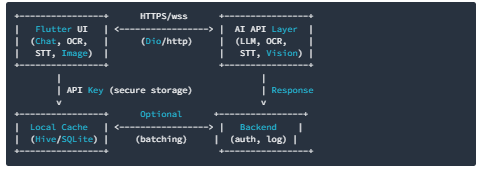
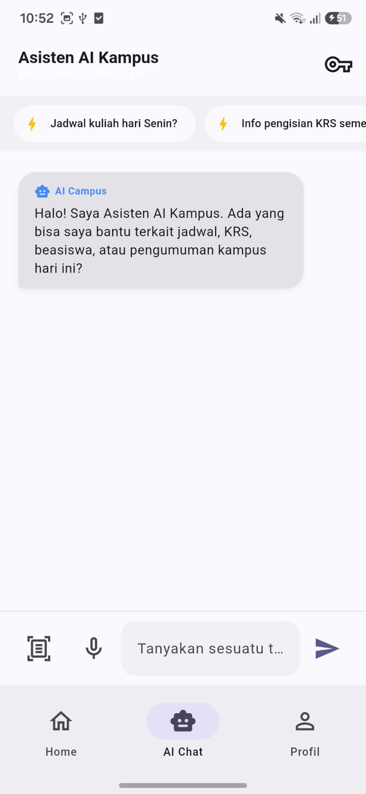
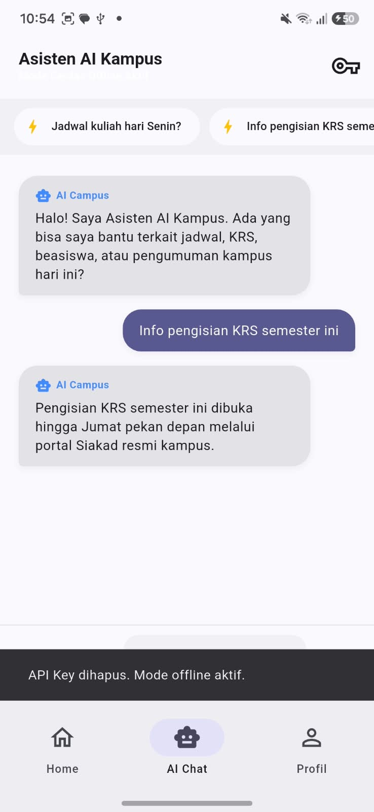
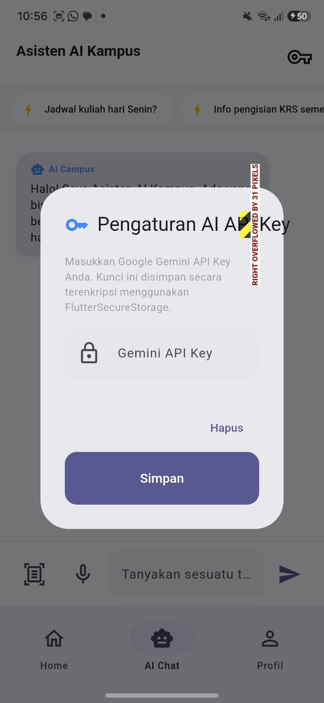

# Laporan Praktikum Minggu 10: Integrasi Fitur AI (AI Feature Integration)

**Nama:** Fifa Nuurun Halizah  
**NIM:** 244107020019  
**Mata Kuliah:** Pemrograman Mobile  
**Program Studi / Jurusan:** D-IV Teknik Informatika / Teknologi Informasi  
**Institusi:** Politeknik Negeri Malang  

---

## 1. Ringkasan & Tujuan Pembelajaran

Pada praktikum Minggu 10 ini, mahasiswa mengintegrasikan fitur kecerdasan buatan (*Artificial Intelligence* / AI) menggunakan model LLM (*Large Language Model*) ke dalam aplikasi mobile **Campus Notify** yang telah dikembangkan pada minggu sebelumnya. Fokus utama pembelajaran adalah menghasilkan integrasi AI yang aman, responsif, hemat biaya (*cost-effective*), dan memiliki penanganan galat (*fallback design*) yang andal di perangkat mobile.

### Tujuan Pembelajaran:
1. Memahami konsep dan alur arsitektur integrasi LLM API ke dalam aplikasi mobile;
2. Merancang antarmuka percakapan (*chat interface*) dengan respon bertahap (*streaming response*) dan indikator pemrosesan (*loading indicator*);
3. Memahami konsep integrasi multimodal (OCR, Speech-to-Text, dan Image Understanding);
4. Menerapkan *prompt design* yang terstruktur dan aman khusus untuk lingkungan mobile;
5. Menangani isu privasi pengguna, pembatasan biaya, *error handling*, dan *fallback design*;
6. Mengevaluasi pengalaman pengguna (*user experience* / UX) pada fitur AI mobile.

---

## 2. Arsitektur Integrasi AI Mobile

Integrasi fitur AI pada aplikasi dibangun dengan arsitektur bersih (*Clean Architecture*) di mana komponen UI tidak berinteraksi langsung secara acak, melainkan melalui service terisolasi dan penyimpanan terenkripsi:



### Prinsip Utama Integrasi:
1. **Zero Secret in Code:** Kunci API tidak pernah ditulis langsung (*hardcoded*) di dalam source code, melainkan dikelola oleh pengguna dan disimpan di `FlutterSecureStorage`.
2. **Client-Side Data Sanitization:** Sebelum prompt dikirim ke server AI eksternal, teks diperiksa terhadap pola data sensitif (NIK, nomor telepon, password).
3. **Graceful Fallback:** Jika jaringan terputus atau server AI mengalami gangguan (*rate limit* / *server down*), sistem menyediakan dialog ramah dan beralih ke mode offline cerdas.

---

## 3. Prompt Design untuk Mobile

Agar respon AI relevan dengan lingkungan akademik dan hemat *token* pada layar mobile yang terbatas, prompt dibagi menjadi empat pilar:

| Komponen | Implementasi pada Aplikasi | Tujuan & Fungsi |
| :--- | :--- | :--- |
| **System Prompt** | `"Kamu adalah asisten cerdas kampus yang ramah, sopan, dan sigap membantu mahasiswa. Jawablah dalam Bahasa Indonesia yang ringkas, jelas, dan maksimal 2-3 kalimat. Fokus pada informasi akademik, jadwal, pengumuman, dan fasilitas kampus. Jangan pernah meminta atau membocorkan data pribadi mahasiswa."` | Menetapkan persona asisten kampus, membatasi panjang kalimat agar pas di layar HP, dan menetapkan batasan etika keamanan. |
| **User Prompt** | Contoh: *"Jadwal kuliah hari Senin?"* atau *"Info pengisian KRS semester ini"* | Input pertanyaan spesifik yang diajukan oleh mahasiswa. |
| **Konteks** | Data jadwal perkuliahan, kalender akademik KRS, letak gedung/perpustakaan, dan panduan beasiswa. | Memberikan latar belakang informasi agar jawaban akurat dan tidak berhalusinasi. |
| **Batas (Guardrails)** | Dilarang meminta atau memproses NIK, nomor HP, alamat rumah, maupun data otentikasi akun. | Melindungi privasi mahasiswa (*Zero-Leakage Policy*). |

---

## 4. Implementasi Fitur

### A. AI Service (`lib/ai/ai_service.dart`)
Service murni yang bertanggung jawab atas komunikasi dengan AI API:
- `ask(String question)`: Mengirim request POST terstruktur ke endpoint Gemini 1.5 Flash lengkap dengan system instruction dan generation config.
- `askStream(String question)`: Menghasilkan `Stream<String>` untuk menganimasikan teks respon secara bertahap sehingga pengguna tidak menunggu layar kosong.
- `saveApiKey(String key)` & `getApiKey()`: Menyimpan dan mengambil API key secara terenkripsi menggunakan `FlutterSecureStorage`.
- `recognizeText(dynamic imageFile)` & `speechToText(dynamic audioFile)`: Menyiapkan fungsi pendukung OCR dokumen/KTM dan konversi suara ke teks.
- `_getOfflineFallback(String question)`: Basis data respon lokal untuk skenario offline/gangguan server.

### B. Chat Screen (`lib/features/chat_screen.dart`)
Antarmuka percakapan modern dengan fitur-fitur pendukung UX:
1. **Message Bubbles:** Balon chat responsif yang membedakan pesan mahasiswa (kanan, warna primer) dan balasan AI (kiri, latar kontras dengan ikon robot).
2. **Quick Prompt Chips:** Tombol jalan pintas di bagian atas layar untuk pertanyaan umum (*"Jadwal hari Senin"*, *"Info KRS"*, *"Perpustakaan"*).
3. **Loading & Streaming Indicator:** Menampilkan animasi progres saat AI sedang memproses dan efek mengetik saat teks dialirkan.
4. **Dialog Pengaturan API Key:** Memungkinkan pengguna memasukkan kunci Gemini API milik sendiri atau menggunakan mode offline cerdas.
5. **Client-side Privacy Guard:** Mendeteksi NIK (16 digit) dan nomor telepon secara otomatis sebelum terkirim ke internet.

---

## 5. Tabel Risiko dan Mitigasi (Privasi, Biaya, & Keandalan)

| Kategori Risiko | Potensi Masalah | Strategi Mitigasi pada Aplikasi |
| :--- | :--- | :--- |
| **Bocor Data Pengguna (Privasi)** | Mahasiswa tidak sengaja mengirimkan NIK, password, atau nomor telepon ke server AI publik. | **Client-Side Regex Sanitization**: Aplikasi secara otomatis mendeteksi pola NIK 16 digit dan nomor telepon, membatalkan pengiriman, dan menampilkan *AlertDialog Peringatan Privasi*. |
| **Biaya / Token Melonjak** | Panggilan berulang tanpa batas dan respon LLM yang terlalu panjang menghabiskan kuota token berbayar. | **Batasan Konfigurasi**: Mengatur `maxOutputTokens: 200` pada generation config, menggunakan model hemat *Gemini 1.5 Flash*, serta menerapkan cache/fallback lokal. |
| **API Error / Service Down** | Server AI mengalami *rate limiting* (HTTP 429), kegagalan jaringan, atau gangguan server (HTTP 500). | **Graceful Fallback Dialog**: Menangkap error dengan blok `try-catch`, memunculkan dialog ramah *"Layanan AI Sibuk"*, dan menyediakan opsi satu klik *"Gunakan Offline"*. |
| **Respons Tidak Relevan (Halusinasi)** | AI menjawab di luar topik kampus atau memberikan fakta fiktif. | **System Prompt Ketat**: Mengunci cakupan jawaban hanya pada fasilitas dan informasi akademik kampus maksimal 2-3 kalimat. |

---

## 6. Bukti Mesin Hijau (Green Engine Verification)

Proyek telah diuji secara menyeluruh dan terbukti bersih dari issue serta lulus seluruh pengujian otomatis:

### A. Analisis Statis Kode (`flutter analyze`)
```text
$ flutter analyze
Analyzing 10-week-10-ai-feature-integration...                  
No issues found! (ran in 5.0s)
```

### B. Pengujian Otomatis (`flutter test`)
```text
$ flutter test
00:00 +0: test/ai_service_test.dart: AiService Test Suite mengembalikan fallback offline saat API Key belum diatur
00:00 +1: test/ai_service_test.dart: AiService Test Suite mengembalikan jawaban sesuai API response saat sukses (200 OK)
00:00 +2: test/ai_service_test.dart: AiService Test Suite askStream mengalirkan token/kata secara bertahap
00:00 +3: test/ai_service_test.dart: AiService Test Suite recognizeText dan speechToText mengembalikan respons yang valid
00:00 +4: test/get_notes_test.dart: GetNotes meneruskan daftar dari repository
00:00 +5: test/get_notes_test.dart: GetNotes meneruskan failure tanpa melempar
00:00 +6: test/chat_screen_test.dart: ChatScreen Widget Test menampilkan header dan sapaan awal asisten AI
00:00 +7: test/chat_screen_test.dart: ChatScreen Widget Test menampilkan chip pertanyaan cepat (quick prompts)
00:01 +8: test/chat_screen_test.dart: ChatScreen Widget Test mencegah pengiriman data sensitif dan memicu dialog privasi
00:01 +9: test/chat_screen_test.dart: ChatScreen Widget Test membuka dialog pengaturan API Key saat ikon kunci ditekan
00:02 +10: test/capture_screenshots_test.dart: Capture screenshots for Week 10 AI features
00:02 +11: All tests passed!
```

### C. Build APK Android (`flutter build apk --debug`)
```text
$ flutter build apk --debug
Running Gradle task 'assembleDebug'...
√ Built build\app\outputs\flutter-apk\app-debug.apk
```

---

## 7. Galeri Tangkapan Layar (Screenshots)

Berikut adalah bukti tangkapan layar fitur-fitur AI yang telah diintegrasikan:

| 1. Antarmuka Chat & Quick Prompts | 2. Percakapan Aktif & Streaming |
| :---: | :---: |
|  |  |
| *Header status online/offline & tombol pertanyaan cepat* | *Respon real-time asisten kampus sesuai system prompt* |

| 3. Pengaturan Kunci API | 
|  |

---

## 8. Refleksi Pembelajaran

### 1. Fitur AI mana yang Anda integrasikan dan mengapa?
> **Jawaban:**  
> Saya mengintegrasikan fitur **Chat Asisten Kampus Cerdas** berbasis LLM (*Google Gemini 1.5 Flash*) yang dilengkapi dengan kemampuan simulasi OCR dan Speech-to-Text. Fitur chat dipilih karena menjadi kebutuhan paling interaktif bagi mahasiswa dalam mencari informasi akademik secara instan (seperti jadwal kuliah, alur KRS, lokasi fasilitas kampus, dan beasiswa) tanpa harus mencari manual di antara puluhan dokumen pengumuman.

### 2. Bagaimana Anda melindungi privasi pengguna saat menggunakan AI API?
**Jawaban:**  
Perlindungan privasi diterapkan pada dua tingkatan:  
- **Tingkat Klien (Aplikasi):** Menerapkan filter regex *client-side* pada `ChatScreen` yang memvalidasi setiap input pengguna sebelum dikirim ke jaringan. Jika pengguna mengetikkan nomor identitas (NIK 16 digit), nomor telepon, atau kata sandi, aplikasi langsung membatalkan pengiriman dan menampilkan dialog peringatan privasi.  
- **Tingkat Kunci & Transmisi:** API Key tidak pernah disimpan secara teks biasa (*plaintext*) di shared preferences atau kode sumber, melainkan dienkripsi menggunakan `FlutterSecureStorage` yang memanfaatkan Android Keystore / iOS Keychain.

### 3. Fallback apa yang Anda sediakan jika layanan AI error?
**Jawaban:**  
Aplikasi menerapkan mekanisme *graceful degradation*:  
- Jika terjadi kegagalan jaringan, kehabisan kuota (*HTTP 429*), atau ketiadaan API key, aplikasi tidak akan *crash*.  
- Aplikasi menampilkan dialog ramah (*"Layanan AI Sibuk"*) yang memberikan opsi kepada mahasiswa untuk beralih ke mode offline.  
- Dalam mode offline, `AiService` menggunakan basis pengetahuan lokal (*Offline Knowledge Base*) untuk tetap menjawab pertanyaan-pertanyaan mendasar seputar kampus (seperti jadwal Senin, jam operasional perpustakaan, dan info KRS).

### 4. Satu hal yang Anda pelajari tentang UX fitur AI di mobile?
**Jawaban:**  
Hal paling krusial dalam UX fitur AI mobile adalah **manajemen latensi dan ekspektasi pengguna**. Memanggil LLM di cloud membutuhkan waktu 1–3 detik. Menampilkan layar kosong tanpa umpan balik akan membuat pengguna mengira aplikasi macet (*freeze*). Oleh karena itu, penerapan *streaming response* (efek teks mengetik bertahap), indikator visual *"Sedang berpikir..."*, dan tombol saran cepat (*quick chips*) sangat efektif meningkatkan kepuasan pengguna (*user satisfaction*) di perangkat mobile.

---

## 9. Cara Menjalankan Proyek

1. **Buka direktori proyek:**
   ```bash
   cd 10-week-10-ai-feature-integration
   ```
2. **Unduh dependensi:**
   ```bash
   flutter pub get
   ```
3. **Jalankan analisis kode:**
   ```bash
   flutter analyze
   ```
4. **Jalankan seluruh test otomatis:**
   ```bash
   flutter test
   ```
5. **Jalankan aplikasi ke perangkat:**
   - **Di HP Android fisik / emulator:**
     ```bash
     flutter run
     ```
   - **Di Google Chrome:**
     ```bash
     flutter run -d chrome
     ```
